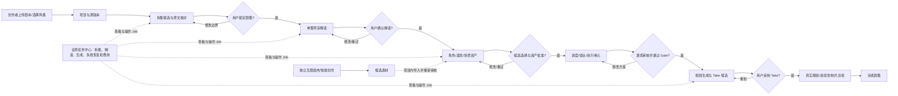
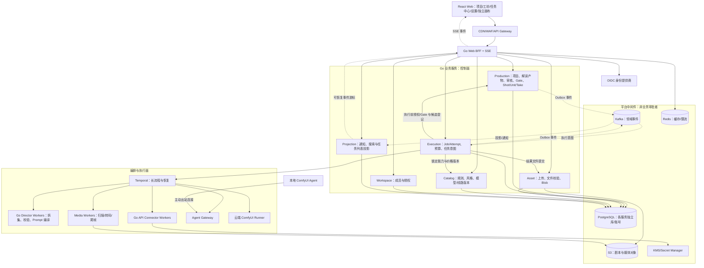

# 镜序 Studio 技术实现方案

版本：1.1（待评审）  
日期：2026-09-29  
架构：前后端分离、领域微服务、持久化任务编排、隔离执行面  
状态：M0 服务体系已形成首条真实调用链；生产级 HA、完整 M1/M2 业务闭环及下述可用性指标仍未验收

## 1. 结论与现状

采用 React Web + Go 业务微服务与 Go 导演领域 Runtime/Worker。现有 Python 规则作为迁移的对照实现和测试样本来源，不是目标生产请求链路上的必选服务。使用 PostgreSQL 保存权威业务事实，Temporal 驱动长任务，Kafka 传播业务事件，Redis 支撑非权威缓存和入口限流，S3 兼容对象存储保存媒体，OIDC 身份提供商与 KMS/Secret Manager 管理身份和凭据，Kubernetes 提供部署与故障隔离。

高级架构设计的重点不是微服务数量，而是数据所有权、关键事务边界、失败语义、资源隔离和可验证的恢复能力。首期建立有限数量的独立服务，不按每张表、每个页面拆服务；后续按负载、故障域和团队责任拆分。

### 1.1 已存在、可以复用

- `apps/web`：React 19、TypeScript、React Router、Zustand、Tailwind、Radix UI；现有路由、组件和工坊信息架构保留。
- `scripts/shotdesigner/`：覆盖、空间、镜头、资产、审核、依赖、Prompt 与执行证据的领域逻辑和校验器。
- `config/workflow/`、`config/adapters/`：工作流规则、依赖和 Adapter 合同，需版本化发布。
- `tests/`：Python 领域回归测试；前端当前只有 3 项 Gate/路由单元测试，不是完整产品 E2E。

### 1.2 当前已完成与尚未完成的边界

当前已完成 M0 的首条真实项目链路：`apps/web` 通过 Nginx 进入 `services/web-bff`，BFF 使用固定的本地开发身份调用 `services/workspace` 做成员授权，再调用 `services/production` 的内部项目 API；Production 使用 PostgreSQL 持久化项目，前端项目列表、创建、幂等重放和错误状态均走该链路。Workspace、Production、Web BFF 和 Web 都已有独立 OCI 镜像，并由本地 Compose 启动。该开发身份（`ws_dev / user_dev`）仅用于本地验证，尚未替代 OIDC。

以下能力仍未完成，不能当作已交付：真实 OIDC 会话与多租户身份、Temporal 业务 Workflow、Go Director Worker、Catalog Service、Projection/SSE、Provider/ComfyUI 执行面、媒体扫描与转码、生产级迁移历史、HA/备份恢复和完整漫剧工坊业务闭环。Execution/Task Service 已完成首版真实闭环：独立 PostgreSQL、Job/Attempt、幂等创建、查询、取消、重试、内置开发 Worker 和 BFF 转发，仍不是生产级供应商执行器。Asset Service + PostgreSQL + MinIO 已完成首版上传会话、流式上传、SHA-256 校验、提交和按项目查询；但暂不包含签名下载 URL、媒体扫描、转码/缩略图、派生资源、病毒检测和审核状态机。前端 Store、本地任务计时器、占位媒体和 mock 哈希不能作为服务端审核事实源。

旧 `docs/commercial/04-technical-solution.md` 是方向参考。本方案纠正其 Vue 前端选型，收敛首期服务数量，明确审核与 Gate 的一致性边界；与本方案冲突的部分以本方案和当前 `docs/product/design.md` 产品边界为准。

### 1.3 产品边界

- 漫剧导演台采用阶段式工坊；独立 `/canvas` 承载画布，不作为漫剧审核事实源。
- 主线：项目与源版本 -> 分集核对 -> 导演解读 -> 角色/道具/场景 -> 调度与镜头 -> 执行单元 -> 视频候选 -> 用户采纳 -> 真实尾帧 -> 制片总检。
- 首批真实闭环聚焦漫剧、资产、图片/视频任务和一种受控 API 线路。
- 本地 ComfyUI、云端 ComfyUI 分阶段接入；社区、支付、复杂画布编排和多区域双活不阻塞首批业务闭环。
- 配额、预算保护和供应商用量记录必须首期具备；商业钱包、支付、发票属于后续 Billing 域。

## 2. 架构原则与质量目标

### 2.1 必须成立的不变量

1. 一个服务拥有一类事实，其他服务通过契约访问，不直接跨库读写。
2. Job 成功不等于内容批准；模型、Worker、Temporal 均无权生成用户批准。
3. 审核绑定产物版本、内容哈希、依赖快照、真实用户和明确决定。
4. 已发布规则、源版本、产物版本、Adapter 和执行计划不可原地改写。
5. 同一 Unit 同时只有一个当前采纳 Take；下一连续单元使用已接受视频的真实尾帧。
6. 上游变更保留历史，使实际依赖的下游失效；失效检查未结束时不得放行生产。
7. 消息按至少一次处理，靠数据库约束和幂等提交避免重复业务效果，不承诺供应商侧天然 exactly-once。
8. 任务提交确认必须先持久化；浏览器关闭不影响执行；服务端数据库不可用时不能假装接单成功。
9. Secret、媒体二进制和长期签名 URL 不进入事件或 Temporal 历史。
10. 生产与演示彻底隔离，不把浏览器旧 Store 自动迁移成真实批准事实。

### 2.2 初始 SLO 与容量基线

以下是待通过压测和故障演练验证的目标，不是当前能力或无条件 SLA。

| 项目 | 首期目标/约束 |
|---|---|
| 控制面 | 月度可用性 99.9%；成熟后评估 99.95% |
| 常规查询 | P95 < 800ms；排除大文件传输、模型执行和复杂导出 |
| 异步提交 | P95 < 1.5s 返回已持久化的 Job/操作 ID；排队与执行耗时分别展示 |
| 重复效果 | 内部重复批准、重复候选提交、重复记账必须被约束阻止 |
| 同区域 HA | 在同步复制覆盖的已确认事务范围内，目标 RPO=0；故障转移必须有旧主隔离 |
| 跨区域灾备 | 初始 RPO <= 15min、RTO <= 2h，以实际恢复演练为准 |
| 媒体 | 已提交结果具备对象 ID、SHA-256、大小、格式、来源和引用关系 |
| 调度公平 | 按 Workspace/Provider/GPU 池限额，单个租户不能耗尽全部执行资源 |

压测暂以 1,000 个活跃会话、200 RPS 读取、20 RPS 业务写入作为可调整的验收档位；不是商业容量承诺。任务另测突发提交、队列积压和长执行：稳定到达率必须低于有效完成率 `并发槽位 / 平均占用时长`，超限应排队或返回 429，而不是无限扩 Worker。容量规划同时测对象存储吞吐、SSE 连接数、数据库写入和外部 API 配额。

“已接受任务不丢失”限定于正常运行和规定 HA 故障范围。跨区灾难在 RPO 窗口内可能丢失事务；只有同步跨区持久化并承担相应延迟/成本，才能提高该承诺。灾备时必须核对外部在途任务与费用，不能直接全部重提交。

## 3. 业务架构图：用户究竟在完成什么

下图只描述业务，不对应微服务数量。方框是用户看得到的工作区，菱形是需要人的决定；任务中心贯穿各阶段，但它只管理执行任务，不代替审核。



业务上有三条并行的状态线：**内容审核**（草稿、候选、批准、失效）、**任务执行**（排队、运行、成功、失败）和**项目进度**（已完成多少个经审核的阶段）。任务执行成功只产生候选；只有用户对确定版本和哈希做出决定，内容才进入下一 Gate。上游版本变化会使真实依赖的下游待复核，而不抹掉历史。

| 业务能力 | 用户入口 | 事实归属 | 异步任务 |
|---|---|---|---|
| 项目与源剧本 | 项目列表/项目总览 | Production；原文件归 Asset | 上传扫描、文本提取、拆集 |
| 导演工坊 | 剧集的七阶段 | Production | 解读、规则校验、图片与视频 |
| 资产库 | 全局资产/项目资产 | Blob 归 Asset；审核与复用范围归 Production | 媒体校验、派生图 |
| 任务中心 | 全局 `/tasks` 与工坊内任务详情 | Execution 管 Job/Attempt；Production 管审核 | 所有长任务的查询、取消、受控重试 |
| 智能创作/无限画布 | 独立页面 | 各自工作区定义；执行结果归 Asset | 共用 Execution，不继承漫剧 Gate |
| 设置/模型/渠道 | 设置页 | Catalog + Workspace 策略 | 渠道探测、Agent 健康检查 |

## 4. 逻辑架构图：系统如何协作

实线表示有明确服务契约的命令/查询，虚线表示事件或长任务通知；每个领域服务拥有自己的数据库权限。图中的 PostgreSQL 可共用托管集群，但服务之间不能直接跨库读取。



**从页面点击到业务完成：** 浏览器发命令给 BFF；Production 在自己的事务里核验版本、权限和 Gate，并通过 Outbox 发出执行意图；Execution 消费意图后落盘 Job，Temporal 让 Go Worker 执行；结果文件由 Asset 校验入库，Production 登记内容候选；Execution 标记 Job 成功并发事件；用户回到工坊审核候选，Production 才推进业务阶段。任务中心读取 Job 列表和详情，不能直接修改 Production 的批准记录。

## 5. 部署拓扑图：高可用在哪里

```text
用户 -> CDN/WAF/LB -> 跨可用区的 Gateway/BFF/Go 服务副本
                            |                |
                    托管 PostgreSQL HA    Temporal + Kafka 集群
                            |                |
                    对象存储 S3       CPU Worker 池 / 独立 GPU 池
                                           |
                                   本地 Agent 出站连接
```

这是单区域多可用区的目标拓扑，不代表当前仓库已部署。数据库的同步复制、Worker 恢复、Kafka 副本、对象存储持久性、超时与预算对账都要分别验收；只把 Go 服务副本数设为 3 并不能获得端到端高可用。跨区域首期是灾备切换，不是双区域同时写。

## 6. 总体架构（文字索引）

```text
React Web / Local ComfyUI Agent
       |
CDN + WAF + Load Balancer
       |
API Gateway -------- OIDC Identity Provider
       |
Web BFF / SSE Gateway
       |
       +-- Workspace Service       成员、授权、租户策略
       +-- Production Service      项目/源版本/剧集/审核/依赖/Gate/Shot/Unit/Take
       +-- Asset Service           上传、媒体校验、不可变 Blob、签名访问
       +-- Catalog Service         模型、渠道、规则/风格/镜头模板、Adapter
       +-- Execution Service       Job/Attempt/预算/执行计划/外部任务映射
       +-- Projection Service      通知、搜索与页面读投影
                    |
          Transactional Outbox
          /                   \
 Temporal Start/Signal       Kafka domain events
          |                   |
 Temporal Workflow          Inbox / projection / reconciliation
          |
          +-- Go Director Workers       解读编排、编译、领域校验
          +-- API Connector Workers     官方/受控中转 API
          +-- Media Workers             解析、扫描、转码、真实尾帧
          +-- Agent Gateway             用户设备主动出站连接
          +-- Cloud Runner Controller   独立 GPU 池、ComfyUI Runner

PostgreSQL | S3 Object Storage | Redis | KMS/Secret Manager
OpenTelemetry | Metrics | Logs | Traces | Kubernetes/GitOps
```

控制面不运行推理、不直接处理长视频；GPU Runner 无业务数据库权限。页面查询和长任务分离，资产字节流不经过 BFF、Kafka 或 Temporal。

## 7. 技术选型与中间件职责

| 层级 | 建议选型 | 职责与边界 |
|---|---|---|
| Web | 现有 React + TypeScript + Vite | 保留 UI；TanStack Query 管理服务端数据，Zustand 仅管理界面状态/未提交草稿 |
| Gateway | APISIX | TLS、路由、限流、请求大小、接入日志；不实施领域 Gate |
| BFF/控制面 | Go + chi + pgx/sqlc | API、授权、事务、契约聚合；首期统一语言与服务模板 |
| 导演领域 Runtime | Go 纯领域包 + Go Temporal Worker | 新生产链路统一 Go；Python 仅作迁移对照，不在请求线程运行旧 CLI |
| 主数据库 | 托管 PostgreSQL HA | 事务、不变量、Outbox/Inbox、审核日志；每服务独立数据库/账号 |
| 长流程 | Temporal + Go SDK | 持久化计时器、Activity、人工等待、重试与恢复；不是业务审核事实源 |
| 事件总线 | 托管 Kafka + Schema Registry | 业务事件、投影、用量、审计、回放；不再承担另一套执行调度 |
| 缓存 | 托管 Redis 主从高可用 | 缓存、短期会话、进度通知加速、入口限流；不做权威余额、Job 或锁版台账 |
| 媒体 | 托管 S3/OSS 同类对象存储 | 私有对象、分片上传、版本、校验、生命周期；本地开发用兼容实现 |
| 身份 | 托管 OIDC，私有部署可选 Keycloak | 登录、MFA、身份生命周期；Workspace 资源权限由业务服务实施 |
| Secret | 云 KMS + Secret Manager | 加密、轮换、审计、工作负载身份；私有云可选 Vault |
| 可观测 | OpenTelemetry + Prometheus/Grafana + Loki/Tempo 或托管等价物 | Trace、SLI、告警、故障定位；日志默认脱敏 |
| 发布 | OCI 镜像 + Kubernetes + Helm + Argo CD | 多副本、发布、隔离、可回滚配置；迁移采用兼容策略 |

默认不同时引入 RabbitMQ、Celery、Kafka 任务队列与 Temporal 来控制同一 Job。内部短调用先统一 REST/OpenAPI，Agent 长连接/高吞吐接口确有需求时使用 gRPC，不为了微服务而引入两套 DTO。

首期搜索采用授权域内 PostgreSQL 全文/结构化索引；中文检索效果需单独评估。检索规模、延迟或中文相关性达不到目标时接入 OpenSearch。ClickHouse、Service Mesh、全量 CDC 和多区域双活均不是首期必装件。Redpanda 如作为 Kafka 替代，需单独核查当期许可证、托管条件和客户端兼容性，不默认认定可无条件商用。

## 8. 微服务边界与数据所有权

### 8.1 首批独立服务

| 服务 | 权威数据 | 对外职责 |
|---|---|---|
| `web-bff` | 无领域权威库 | 会话、页面聚合、SSE；只能调用服务契约 |
| `workspace-service` | Workspace、Membership、Role、Policy、Agent 授权范围 | 成员管理、租户授权、敏感动作策略 |
| `production-service` | Project、SourceVersion、Episode、ArtifactVersion、Dependency、Review、Gate、Scene、Shot、Unit、Take、当前采纳关系 | 全部漫剧领域命令与生产不变量 |
| `asset-service` | UploadSession、MediaBlob、BlobMetadata、扫描/提交状态、文件访问授权记录 | 上传、校验、候选文件登记、媒体提交与下载 |
| `catalog-service` | Capability、ModelProfile、Channel、AdapterVersion、Rule/Style/Lens 版本及 Workspace 配置 | 能力驱动表单、线路兼容性、模板目录与不可变快照 |
| 模型目录（当前实现） | production `model_channels` + `model_catalog`（capability jsonb、版本 trigger 留档、seed 对齐前端默认） | 设置中心三层目录：L1 渠道 → L2 类型 → L3 能力/计费；同类型按起步单价排序 |
| `execution-service` | Job、JobAttempt、ExecutionPlan、ProviderTaskRef、Reservation、Usage、预算策略、幂等结果 | 提交、执行、取消、状态查询、供应商恢复与成本保护 |
| `projection-service` | 可重建通知、搜索和页面投影、事件游标 | 查询加速；不批准、不推进 Gate、不覆盖权威状态 |

以上服务分别发布镜像、拥有迁移和数据库权限。首期可共用一个托管 PostgreSQL HA 集群，但独立数据库/账号/连接配额，不跨库 Join；Execution、Production 和 Temporal 持久化应按负载逐步迁到独立集群，消除共享故障域。

### 8.2 特别重要的边界

**审核不单独拆出写服务。** Source/Artifact/Review/Dependency/Gate 同属 Production，批准、版本冲突检查、失效传播和阶段推进才能在一笔本地事务内完成。未来通用 Review 平台可负责评论/分派/待办，但批准命令仍由领域服务执行。

**Asset 管文件，Production 管业务批准。** 文件可用不等于角色定妆被批准；同一个 Blob 可被多个产物引用，但每个引用的审核与场次用法独立。图库是否“全局”由 Production 维护项目内引用范围，不是解除租户隔离。

**三态数据源（设置中心，M0 后新增）：** 前端 `useSettingsStore.catalogSource` = `server`（production 目录 API hydrate）→ `offline-fallback`（BFF 不可达，本地缓存）→ `demo`（内置默认）。写操作 server 态乐观同步（`PUT /internal/v1/catalog/...`），失败降级离线并提示。**Execution provider 路由骨架：** `services/execution/internal/provider` 声明六适配器（jimeng/minimax/grsai/google/openai/comfy）与 Resolver（按 channel_id 路由、按 model type 校验）；无租户凭据时 Generate 返回 `ErrCredentialsNotConfigured`（明确错误，不假装调通）；真实鉴权待 workspace 凭据加密注入后接入。

**Catalog 管定义，Execution 锁定计划。** 运行中的任务绑定模型、Adapter、规则、参数、线路、输出合同和价格版本；目录更新不改变已提交任务。规则版本只是受校验模板，不允许执行用户上传代码。

**Job 与 Temporal 不形成两套调度器。** Execution 的 Job/Attempt 是业务状态权威源；Temporal 管持久化执行历史与下一步活动。Temporal Activity 调用 Execution 的幂等命令推进状态，不凭 Workflow 结束事件直接写业务结果。定期对账两者，修复漏启动/漏事件，不由第二个调度器重新执行供应商请求。

### 8.3 执行部署单元

- `director-workers`：Go 版本化 DTO + 领域包执行拆集、空间/镜头/覆盖校验与 Prompt 编译；不得有通用 shell 执行端点。
- `connector-workers`：按 Provider/能力隔离任务队列、并发与熔断，单家故障不拖垮全部生成。
- `media-workers`：恶意文件扫描、DOCX/PDF 提取、元数据、转码、真实尾帧；FFmpeg 等在限资源沙箱运行。
- `agent-gateway`：独立长连接扩展与设备认证；不能替用户浏览任意内网。
- `runner-controller/runners`：独立 GPU 故障域，无业务库访问，仅有指定 Job 输入/输出权限。
- Temporal Workflow Worker 可随 Execution 镜像独立角色部署；本身不另建第二个业务任务数据库。

支付账本、社区发布、工作流定义在需求和流量明确后形成独立服务。画布文档及其版本未来由 Workflow Definition 域拥有，画布运行调用同一 Execution 契约，不共享漫剧 Gate。

## 9. 数据模型与一致性

### 9.1 Production 核心关系

```text
Workspace -> Project -> SourceScriptVersion -> EpisodeRevision
                              |                    |
                         source text          Scene -> Shot -> Unit -> Take
                                                   |
Artifact -> ArtifactVersion -> DependencyVersionSnapshot
                 |
             ReviewDecision -> GateRevision
                 |
           immutable MediaBlob reference (Asset Service)

ProjectAssetUsage -> source episode / global scope / pinned artifact version
```

所有租户资源带 `workspace_id`。租户内外键使用 `(workspace_id, id)` 的约束避免跨租户误引用；服务授权是第一层，PostgreSQL RLS 是第二层，连接池必须在事务内设置并清理租户上下文，不用全局连接变量泄漏租户。

关键约束：

- `source_versions(project_id, version)`、`artifact_versions(artifact_id, version)` 唯一，内容不可变。
- `review_decisions` 追加，不更新旧决定；存储 actor、action、statement、version、SHA-256、dependency snapshot、时间和请求 ID。
- `units.current_adopted_take_id` 由事务内 CAS 更新，校验 Take 属于该 Unit 且通过审核；使用复合 FK/等价约束保证引用归属。
- `job_intents`、执行提交和输出提交都有业务唯一键，不只依赖 Redis 防重复。
- Source 修订建立新 EpisodeRevision/产物命名空间，旧剧集和审核保留可追溯，不照搬演示版“清空旧投影”的做法删除业务历史。

源文件、提取文本和结构化 IR 分别计算 SHA-256。`sourceSpan` 统一按不可变提取文本的 Unicode code point 半开区间 `[start,end)` 编码，不混用 JavaScript UTF-16 长度、UTF-8 字节偏移；服务提供对应切片和版本化索引。完整性校验涵盖所有正文及允许的非剧情标记，不允许通过 trim/重新归一化静默改变已锁文本。

### 9.2 批准事务

1. 验证用户和 Workspace 权限，接收 `If-Match`、产物版本、哈希和依赖 revision。
2. 锁定当前产物/作用域 revision，检查内容、当前依赖、资产提交凭证、阻塞与用户决定。
3. 在同一事务追加审核、更新当前状态、重新计算必要 Gate，写入 Outbox。
4. 提交后返回权威状态；冲突返回 409/412，前端显示变化并重新核对。

批准不能依据异步搜索投影、SSE 中的旧事件或前端按钮已变绿。高风险权限变更要求 Workspace 在线授权核验，不仅相信长 TTL 的成员缓存。

### 9.3 失效传播与生产提交屏障

上游变更在 Production 内产生新 revision。小依赖图同事务更新实际受影响下游；大图先同步把受影响作用域设为 `INVALIDATION_PENDING` 并提升 epoch，后台遍历依赖完成后解除屏障。任务提交/批准比较依赖快照和 epoch，旧快照永不因为异步失效尚未到达而被放行。

Production 产生带 scope epoch 的幂等执行意图并写 Outbox；Execution 持久化接单。Worker 真正向供应商提交前必须获得 Production 对该意图的授权，在线核对 Gate/权限/依赖；校验失败或服务不可用则不提交。授权与上游修改按 epoch 排序。

外部供应商调用无法与数据库更新原子完成。如果授权后上游立即变化，任务可能已提交并产生费用：将其明确标记为基于旧快照的在途结果，尽力取消，完成后只能作为历史候选，不可自动成为当前批准结果。UI 应在有在途任务时提示修改影响，不声称零时间窗口。

### 9.4 跨服务一致性

- 单服务事务保证本地不变量；跨服务使用 Outbox/Inbox、幂等命令和 Temporal Saga，不上分布式数据库事务。
- Production -> Execution 的 intent 与 execution Job 分离；BFF 不串联两个不可恢复的同步写请求。
- Asset 完成文件提交后返回不可变凭证；Production/Execution 存凭证引用，不复制文件状态控制权。
- Asset 安全撤销事件传播期间，执行前在线校验 Blob 可访问且未隔离，失败关闭；被撤销 Blob 不因旧批准可继续使用。
- 没有引用的文件走延迟 GC；有引用文件不可直接删除，法务/租户删除采用受审计删除编排。

## 10. API、事件和前端接入

### 10.1 契约优先

外部 `/api/v1` REST + OpenAPI；统一错误结构、分页、字段定义、权限和兼容策略。生成 TypeScript/Go 客户端；迁移期间旧 Python CLI 可用同源 JSON Schema 验证输入输出。版本升级先支持双版本再迁移，不共享 ORM 实体当契约。

主要接口：

| 用例 | 接口建议 | 核心约束 |
|---|---|---|
| 上传 | `POST /uploads`、`POST /uploads/{id}/complete` | 签名、校验、隔离、服务端哈希 |
| 建项目 | `POST /comic-projects` | 引用已校验源文件/文本；幂等返回 |
| 修订原文 | `POST /comic-projects/{id}/source-versions` | 新版本，不覆盖旧事实 |
| 拆集 | `POST /comic-projects/{id}/episode-analysis-runs` | sourceVersion + ruleVersion + operation key |
| 锁定拆集 | `POST /episode-analysis-runs/{id}/decisions` | 覆盖、顺序、边界、当前源版本 |
| 工坊查询 | `GET /comic-projects/{id}/episodes/{episodeId}/workbench` | 权威 Gate、版本、阻塞项、下一步 |
| 解读 | `POST /episodes/{id}/analysis-runs` | source/target/rule/input snapshot |
| 编辑产物 | `POST /artifacts/{id}/versions` | 基于版本创建新草稿 |
| 人工批准 | `POST /artifacts/{id}/decisions` | If-Match + version + hash + decision |
| 提交生成 | `POST /generation-intents` | Gate、预算、能力与依赖快照 |
| Job | `GET /jobs/{id}`、`POST /jobs/{id}/cancel` | 状态查询；取消是请求而非成功承诺 |
| 采纳 Take | `POST /units/{id}/take-decisions` | 当前 Unit revision + Take/媒体证据 |
| 事件恢复 | `GET /events?cursor=...` | 认证、Workspace 过滤、游标可恢复 |
| 渠道与模型 | `GET/POST /channels`、`POST /channels/{id}/test`、`GET /models` | Key 只写、健康时间、能力兼容 |

所有副作用接口带 `Idempotency-Key`；唯一域为 Workspace + command + key，记录 payload hash。相同 key 同 payload 返回原结果，不同 payload 返回 409。保留周期和到期语义写进契约；长期业务唯一性由 operation intent/数据库约束保证，不只靠短期响应缓存。

标准错误包括 `code`、`message`、`request_id`、`retryable`、`field_errors`、`blocking_artifacts`。401/403 区分认证和授权，429 带 Retry-After，503 明确未接单或需凭幂等键查询，不暴露供应商 Secret/原始错误栈。

### 10.2 事件契约

```json
{
  "event_id": "evt_...",
  "event_type": "production.artifact.reviewed.v1",
  "schema_version": 1,
  "producer": "production-service",
  "workspace_id": "ws_...",
  "aggregate_id": "artifact_...",
  "aggregate_version": 12,
  "occurred_at": "2026-09-29T08:00:00Z",
  "trace_id": "...",
  "payload": {
    "artifact_version_id": "av_...",
    "review_id": "review_..."
  }
}
```

Topic 按领域划分，按 Workspace + aggregate ID 分区；只保证同一聚合的有序处理，不假设跨 Topic 全局顺序。生产者业务写入与 Outbox 同事务；消费者 Inbox 去重、revision 校验和投影更新同事务。重复消息忽略，旧 revision 不覆盖新值，版本缺口触发权威快照补齐。

Outbox relay 首期轮询锁定批次，避免一开始引入 CDC；有 owner、积压告警和回放工具。消费者遇到不可恢复错误进入 DLQ，必须阻止错误后续事件使同一聚合投影跳过约束。高频进度可以合并，状态/审核/用量事件不能丢弃。

### 10.3 SSE 不是任务事实源

BFF 从 Projection 的持久事件游标读取并通过 SSE 推送，Redis Pub/Sub 仅作唤醒加速。断线发送 Last-Event-ID/游标；超过保留窗口返回明确 reset 信号，前端重新拉取快照。每条事件再次按 Workspace/资源授权过滤。

使用同源 HttpOnly 会话 Cookie，禁止在 SSE URL 放 access token；禁用代理响应缓冲，设心跳、连接/租户限额和空闲超时。前端根据 aggregate revision 更新 Query 缓存，不因事件丢失失去服务端状态。

### 10.4 前端替换策略

1. 保留路由和视觉结构，建立生成 SDK + Query Hooks + 明确的 loading/error/forbidden/stale 状态。
2. React Query 负责项目、剧集、资产、Job、设置；Zustand 仅存 UI 偏好和未提交编辑草稿。
3. 删除生产模式中的本地 tick 推进器、mockHash、假审核和 placeholder 成功结果；未接入功能由 Feature Flag 禁用。
4. Mock 使用 MSW/独立 demo 环境，不能在服务失败时静默回退成假数据。
5. 不乐观显示“批准/生成成功/已完成”；先显示提交中，再读取服务端确认。
6. 搜索读投影，关键操作读权威详情；跨租户切换清空 Query 缓存和会话上下文。

## 11. 持久化任务体系与 AI 编排

### 11.1 三类状态分离

- Job：`QUEUED -> RUNNING -> SUCCEEDED / FAILED / CANCELLED`，另有明确等待、未知提交和结果提交中的状态。
- 内容：`DRAFT / AWAITING_USER / USER_APPROVED / USER_REJECTED / STALE / SUPERSEDED`。
- 项目：经营状态与进度投影，不代替 Job 或 Gate。

`WAITING_AGENT`、`SUBMISSION_UNKNOWN`、`COMMITTING_RESULT` 是可观测状态/子状态，不藏在一个永远 running 的进度条中。取消用 `CANCEL_REQUESTED`，供应商不支持或执行已完成时明确显示最终事实和可能费用。

### 11.2 Temporal 的使用方式

- Job 首先在 Execution 库事务中落盘，写 start command Outbox，API 返回 Job ID。
- Relay 以 `job/{jobId}` 的确定性 Workflow ID 调用 Temporal Start，重复启动被拒绝/复用；未启动状态可查询和对账。
- Workflow 运行短 Activity：预检、预算预占、输入授权、提交、查询、接收结果、资产 Commit、用量 Commit、结束。
- 长等待使用持久化 Timer、Signal/Update，不让 Worker 占线程/连接 sleep 几小时。
- Provider Webhook 先验签、去重、持久化，再通知 Workflow；丢 Signal 可从已落盘通知/Provider 查询恢复。
- 人工批准先写 Production 的事务审核，再通过 Outbox 通知流程；Signal 本身不能创造批准事实。
- Workflow 只存版本化引用和小型状态；长历史用 Continue-As-New，升级用 Worker versioning/兼容路径。
- 拆集、解读等多步骤 Workflow 与单个生成 Job 有父子关联；浏览器离开不取消。

### 11.3 Go 导演 Runtime/Worker 的职责与迁移

可以全部用 Go 实现导演领域 Runtime/Worker。这里的 Runtime 主要是剧本覆盖、空间/镜头规则、依赖校验、Gate 只读预检和 Prompt 编译，不依赖 Python 才能完成；LLM 推理通过外部 Provider，媒体转码使用受控 FFmpeg/OCR 进程，不要求用 Go 重写这些引擎。Go Production 负责事务、审核与最终 Gate 判定；Go Director Worker 基于不可变输入快照运行领域包，返回结构化候选、校验结果或编译结果，不能直接写 Production 库或更新另一份 `project-ledger.json`。耗时分析由 Temporal 编排，人工批准始终回到 Production 的业务命令。

迁移按可验证的契约推进，而不是逐行翻译脚本：

1. 从现有 `scripts/shotdesigner/` 和回归测试提取版本化输入/输出合同及黄金样本，覆盖中文 Unicode `sourceSpan`、EV/DLG/LOCK、角色/道具/场景、审核、Gate、依赖失效、Shot/Unit、Prompt 和错误码。
2. Go 领域包先实现无副作用的解析、校验与编译；用正常、边界和失败样本对旧 Python 结果做差异测试。差异需要明确是修复旧规则还是保留兼容，不允许靠放宽 Gate 使测试变绿。
3. 逐项切换 Production/Worker 到 Go；每个业务能力只有一个生产写入者。过渡期间 Python 仅在隔离测试或离线验证中读取固定快照，不并行批准、不写生产台账、不重复提交 Provider 请求。
4. Go 契约、回归与历史项目导入通过后逐步退役旧 CLI；保留黄金数据和必要的迁移工具。对确实需要专门模型运行时的能力，作为受限外部执行服务接入，不改变 Go 业务事实所有权。

旧 ledger/manifest 作为导入导出格式：校验通过后导入数据库并记录原件哈希/迁移版本；导出从服务端快照生成，禁止服务运行时一边更新数据库一边改同一份 JSON 台账。

LLM 解读需新增明确 Provider 适配层和版本化输出 Schema：源范围引用、EV/DLG/LOCK、场次、角色、约束、未决项、导演建议分别输出；服务端结构与覆盖校验失败不能自动获批。每次调用记录模型/Prompt/规则/输入版本、用量和质量校验结果；人工修订创建新版本，不让 AI 改写锁定原文。

Go Runtime 发布包绑定代码版本和规则配置 SHA-256。同一执行计划不能从磁盘读取被临时覆盖的新配置；迁移期测试保留旧 CLI 回归与既有领域不变量，生产链路不依赖 CLI。

### 11.4 供应商幂等与未知状态

Worker 租约与 fencing token 防止失效 Worker 回写；数据库唯一约束/状态 CAS 防止重复内部提交。外部提交采用稳定 provider idempotency key（供应商支持时）、ProviderTaskRef 和 attempt 身份。

供应商已经接单但响应丢失时，不默认重试 POST。先按 client request ID/idempotency key/外部记录对账；无法查询且不支持幂等的供应商进入 `SUBMISSION_UNKNOWN`，提示人工确认费用和重提风险。Worker fencing 无法撤销已经发到供应商的请求，必须明确这一限制。

重试分类：限流/暂时不可用退避加 jitter；输入错误/能力不符不重试；已知 task ID 只恢复轮询；最终失败释放尚未消费预算，但真实已发生费用必须保留。盲目切换渠道可能造成重复生成，切换必须形成新的显式 attempt/plan 并受预算与用户策略约束。

### 11.5 调度与预算

入口 admission control 校验 Workspace、Provider 并发、队列容量、GPU 资源和预算。Redis 支撑快路径限流，权威 reservation 和费用记录使用 PostgreSQL 事务/唯一键，Redis 故障不能突破硬预算。

按 Provider/能力/优先级隔离 Temporal task queues；平台调度公平性由 Execution 的租户配额和持久任务调度记录实现，不依赖任务队列天然公平。人工等待任务不占生成槽位，槽位由心跳租约与对账释放。

报价、预占、供应商 usage、最终费用分开；金额用 decimal/整数最小币种单位，禁止浮点余额。超时不能直接判定免费；跨服务已产生的费用不能通过 Saga“回滚消失”。收费上线后再接独立双分录 Billing 账本。

## 12. 三类执行线路

### 12.1 官方/受控中转 API

统一请求锁定 `capability/model/adapter/channel/input versions/parameters/output contract/budget policy`。Connector 负责 compile/submit/query/cancel/result-normalize，不能修改原文、Gate 或审核。

Secret Manager 的短期读取权限不等于供应商 API Key 是短期 Key。优先通过凭据代理发送请求；需要实际 Key 的受信 Connector 仅在内存短时持有，禁止持久化到任务载荷/日志。轮换后在途查询采用受控兼容策略。

渠道 URL 必须管理员配置和受控出站：禁止环回、内网、链路本地、云 metadata、危险协议和重定向绕过；解析后实际连接地址也校验，防 DNS rebinding。Provider 结果下载同样做 SSRF/域名/大小/超时校验，不直接套用当前 CLI 的任意 URL 下载逻辑。

### 12.2 本地 ComfyUI Agent

Agent 使用 Go 设备进程 + 受限 ComfyUI 连接器，主动向平台出站 mTLS 长连接，不要求用户把本机 ComfyUI 暴露公网。配对码一次性、短有效期、绑定 Workspace/设备/操作者；设备证书可撤销，重连重新核验。

Agent 上报版本、ComfyUI 健康、GPU/显存、模型与允许节点清单；平台只能授权指定 Workflow/素材和允许目录，无任意 shell/路径读取能力。Workflow 输入输出槽版本化映射，未知自定义节点不自动安装。

提交 `/prompt` 后持久化平台 JobAttempt 与 ComfyUI `prompt_id`；`/ws` 做进度，`/history/{prompt_id}` 负责恢复核对，`/view` 读取输出，`/upload/image` 上传批准的输入。平台与 Agent 均保存恢复映射；长连接断开不直接重提。

ComfyUI `/prompt` 接单后 Agent 崩溃且未持久化响应存在无法自动消除的窗口。专用实例可以结合 client_id、队列/历史和稳定标记对账，但这些不等同标准服务端幂等保证；无法唯一识别进入 unknown 状态，不宣称断线永不重复。

取消不在共享实例上滥用全局 `/interrupt`；优先删除尚未执行的指定任务，运行任务只有在独占实例/可靠归属时才中断。用户个人 ComfyUI 离线不是平台自动重试全部任务的理由。

首期正式服务要求结果上传平台完成校验；只留本地文件的模式明确标为 `LOCAL_ONLY`，不能冒充团队可访问的 canonical 媒体。离线素材/隐私专属模式后续单独定义访问与验收合同。

### 12.3 云端 ComfyUI Runner

GPU 池按型号/区域/许可/镜像隔离，Runner 镜像及自定义节点固定版本与摘要。Controller 领取短期资源租约，优先热池，支持冷启动上限、预热、显存预检和空闲回收。

实例配置与生成是两个状态机；配额不足/实例启动失败不伪装为模型内容生成失败。任务持久状态不在 Pod 临时盘，模型缓存可丢失重建；真实输出先上传提交，再释放实例。抢占式实例仅用于可恢复且预算允许的执行。

GPU 扩缩容有最大节点数、供应商配额与预算上限，不能跟随队列无界扩展。Cloud Runner 只有指定 Job 输入读取/输出上传权限，不持有平台 DB 或全租户对象存储权限。

## 13. 文件存储、候选与真实媒体证据

上传与结果提交采用两阶段协议：

```text
UploadSession -> private temporary object
 -> size/MIME/virus/metadata/SHA-256 verification
 -> immutable committed MediaBlob + signed metadata receipt
 -> Artifact/Take candidate registration
 -> user review -> canonical reference
```

- 文件 SHA-256 由可信服务端流式计算；不信任客户端声明，也不把 multipart ETag 当 SHA-256。
- 使用不可复写 object key，提交后移除上传写权限；存储对象版本/哈希/长度作为凭证，防校验后被覆盖。
- 临时对象超时可回收；已上传但 DB Commit 失败由对账恢复，不重复下载/生成。
- 下载签名短期、按文件和租户授权签发；私有源剧本/资产不通过公共 CDN 缓存泄漏。
- DOCX/PDF 解压、文本提取和 OCR 在资源受限 Worker 内运行，处理压缩炸弹、恶意嵌入、超大页数；OCR 结果需来源标记和用户核对。
- 图片/视频候选记录尺寸、时长、编码、生成来源、原始响应受限引用及用量；质量由用户决定。

Take 被用户接受后，Media Worker 从该视频固定对象版本提取实际尾帧及时间码并记录哈希。尾帧 Ready 且连续性登记通过才允许后续连续单元执行；采纳成功但尾帧提取失败显示明确阻塞，不使用计划图代替。

制片总检检查源文本覆盖、事件顺序、Shot/Unit 关联、采纳视频与实际尾帧、批准版本、依赖哈希、无 STALE/隔离文件。机器只核验结构和证据，不替用户判断表演、剪辑质量或画面语义绝对连续。

## 14. 多租户与安全

- BFF 推荐 OIDC Authorization Code + PKCE，HttpOnly/Secure/SameSite Cookie；状态变更有 CSRF 防护，严格 CORS，不把长期 Token 放 localStorage。
- Gateway 验证身份，服务再次验证资源归属、动作权限与 session 状态；Workspace ID 不能由请求头任意伪造。
- 权限至少有 owner/admin/director/reviewer/creator/viewer；正式批准、密钥配置、预算变更、Agent 配对/公开发布各有明确动作授权。
- 搜索结果、SSE、缓存键、对象签名、后台 Job 和导出全部租户隔离；后台重试也携带受限上下文。
- 服务通过 Workload Identity 和私网认证访问中间件；最小 DB、Bucket、Secret、NetworkPolicy 权限。
- Prompt 与剧本为敏感内容；不默认记录全文 Trace，不把它们发到外部日志/分析系统。日志禁止 Key、Cookie、签名 URL。
- AI 输入属于不可信数据。剧本中的指令不改变系统规则；LLM 不得发起任意网络/文件/工具动作，输出经 Schema 和领域验证后成为草案。
- 审核、安全审计和成本证据追加保存；高风险审计异步归档到不可变存储，但批准事务不能因异步审计而丢失本地记录。
- 备份加密、轮换与恢复权限分离；明确剧本保留期、数据区域、Provider 处理政策和租户删除规则。

## 15. 高可用、容灾与弹性扩展

### 15.1 部署拓扑

生产控制面建议单区域多可用区，优先托管 PostgreSQL、Kafka、Redis、S3、OIDC 和 Temporal。自建时必须承担仲裁、备份、升级和故障恢复责任，不能用一台 Compose 主机声称高可用。

- Gateway/BFF/核心服务至少 2 副本，条件允许 3 副本跨 3 个 AZ；反亲和、topology spread、PDB、readiness、优雅退出和连接排空。
- PostgreSQL 同步 standby + 自动故障转移 + 旧主 fencing；同步不可用时在延迟与数据保护之间采用明确策略，不静默降级 RPO 承诺。
- Kafka 至少 3 broker/独立故障域，关键 Topic RF=3、min ISR=2、生产者 acks=all，禁止 unclean leader election；Controller 仲裁也跨故障域。
- Redis 主从/自动故障转移，但不假定复制永不丢数据；缓存丢失只影响性能，预算事实仍在数据库。
- Temporal 服务与 persistence/search 依其支持拓扑部署多副本；和业务数据库隔离连接池/容量，升级演练历史重放。
- Object Storage 使用托管持久化与版本/生命周期；自建兼容存储需满足自己的仲裁/故障容忍条件，不混淆 API 兼容与同等可靠性。
- CPU/Connector Worker 与 GPU Runner 分离 node pool/namespace，租户资源配额和网络边界隔离。

首期不做多区域同时写同一业务聚合，避免跨区批准、采纳、预算形成冲突。跨区灾备为单写区域切换，必须冻结旧写入并对账在途任务。

### 15.2 扩展策略

- API/BFF 按 RPS、P95、CPU、连接数扩；SSE 按长连接和出口流量独立扩。
- Runtime/Media Worker 按 Temporal schedule-to-start、队列积压、CPU/内存扩。
- Connector 按 Provider 配额和租户公平性扩，不按 CPU 盲目扩出重复提交。
- GPU 按队列年龄、显存匹配、热池和最大预算扩，独立 cold-start 指标。
- DB 先索引/查询治理、PgBouncer 与连接预算，后拆独立集群/按租户分片；关键写后查询走主库，不读取延迟副本判断 Gate。
- 审核/Job/事件日志按时间归档或分区；媒体走对象存储/CDN，不让业务库保存 base64。

### 15.3 故障与降级

| 故障 | 系统行为 |
|---|---|
| BFF/Worker 被杀 | 请求可重试；已落盘 Job 恢复；旧 Worker 写入被 fencing 拒绝 |
| PostgreSQL 不可用 | 停止批准、接单和硬预算预占；只读缓存明确陈旧，不伪造成功 |
| Temporal 暂时不可用 | 已落盘的 start intent 保留并显示等待编排，设积压上限；恢复后幂等启动 |
| Kafka 不可用 | 核心本地事务继续写 Outbox，设置积压/磁盘阈值；搜索/通知标延迟，不影响权威 Gate |
| Redis 不可用 | 缓存回源限并发；保护关键入口/预算；必要时保守限流，避免 DB 雪崩 |
| Provider 超时 | 查询已知 task；未知接单状态冻结自动重提，熔断该线路 |
| Agent/GPU 离线 | 恢复原任务映射或明确失败；已有费用与候选不被抹除 |
| S3 不可用 | 不标记结果提交成功；继续保留任务/供应商映射，恢复下载/上传而非重新生成 |
| 投影延迟 | 页面回源关键状态，搜索/通知提示延迟；批准不依赖投影 |

跨区复制与备份存在延迟。恢复计划需记录数据库恢复点、对象存储复制水位、Kafka 消费水位、Temporal 状态和 Secret 可用性。按这些水位对账孤立对象/在途外部任务/预算，不简单恢复一个数据库就宣布整个平台恢复。

## 16. 可观测、运维与发布

Trace 贯穿 request -> source/run/intent -> Job -> Attempt -> Provider/Agent -> Blob -> Review/Take。使用 OpenTelemetry，但 Prompt/媒体正文不进入 span attribute。

核心告警：API 错误预算消耗、DB 主从延迟、连接池饱和、Outbox 年龄、Kafka lag/DLQ、Temporal task queue 延迟、unknown submission、Provider 429/超时、预算超额、结果未提交、孤立 Blob、Agent 心跳、GPU 冷启动/闲置成本、投影延迟。

部署采用不可变镜像摘要、签名/SBOM、环境分离和 GitOps。DB 用 expand/migrate/contract，先兼容新旧应用，再后台迁移，最后收缩；不能指望应用回滚自动撤销数据迁移。Workflow/Adapter 升级不改变在途执行计划。

每个服务必须有 owner、SLO、告警接收人、Runbook、容量上限和恢复演练记录。关键操作包括：安全停止接单、隔离 Provider、暂停一个 Workspace、回放事件、修复 unknown task、恢复备份、切换区域、撤销设备、轮换密钥。

## 17. 仓库结构与工程实施

以下为**目标仓库结构**（在本仓库渐进落地，不重建或删除用户前端）。标注「规划中」的目录尚未建立，属后续 Phase 的交付物：

```text
apps/web/                         React 前端
services/
  web-bff/
  workspace/
  production/
  asset/
  catalog/
  execution/
  projection/
workers/
  director/                       Go 领域包 + Temporal Worker
  connectors/
  media/
  agent-gateway/
  cloud-controller/
agents/comfyui-agent/
packages/contracts/
  openapi/
  events/
  schemas/
  generated/                      生成客户端，不共享 ORM
deploy/
  local/                          Compose、模拟 Provider、测试数据
  helm/
  environments/
  infrastructure/
docs/adr/                         架构决策记录（ADR，权威位置）
docs/architecture/                架构图、时序图、ER 图、威胁模型、Runbook
```

> **仓库边界（2026-10-10 拆分）**：原 `scripts/shotdesigner/`、`config/`、`tests/`（Python 规则与校验线）
> 已独立为 [ai-video-shot-designer-skill](https://github.com/quanjunqi/ai-video-shot-designer-skill)，
> 作为迁移对照与离线工具保留，**不参与本仓库的部署与请求链路**。
> 本仓库的 `tests/` 由 `apps/web/tests/`（前端）与各 Go 服务 `internal/**/..._test.go`（后端）承载。

各 Go 服务**目标**标准结构：`cmd`、`internal/domain`、`internal/application`、`internal/adapters`、`api`、`migrations`、`tests`；HTTP handler 不写领域事务，Repository 不直接调用外部 Provider。

> **当前实现（2026-10-10 核实）**：服务采用 `cmd/<service>/` + `internal/<业务域>`（如 `internal/engine`、`internal/project`、`internal/httpapi`）的扁平结构；`api/`、`internal/domain|application|adapters` 分层与服务级 `tests/` 目录**尚未建立**。分层收敛随 Phase 推进按需进行，不要求一次性重构，但**新代码不得跨服务直连数据库**（此条已生效）。

所有中间件在本地/私有化开发环境均通过容器启动，不要求开发机逐项安装。现有 `deploy/local/compose.yaml` 提供 PostgreSQL、Redis，以及 `platform` profile 下的单节点 Kafka + Schema Registry、Temporal、MinIO 和 Keycloak；`app` profile 为 Workspace、Production、Asset、Web BFF 与前端提供独立 OCI 镜像，并执行 Production/Asset 数据库迁移；`test` profile 使用独立测试库运行 Go 集成测试。浏览器通过 Web/Nginx -> Web BFF -> Workspace/Production/Asset 访问 `/api/v1/comic-projects` 与 `/api/v1/assets`，项目和首版资产上传/查询已使用真实 PostgreSQL，Production/Asset 不直接向浏览器开放。详细启动方式及边界见 `deploy/local/README.md`。当前 Compose 是开发/单机验证配置，不是 HA；任务中心、Temporal 业务 Workflow 和 Provider 模拟器尚未实现。后续新增中间件或服务必须同步增加可版本化镜像、健康检查、迁移与容器部署描述，不能依赖宿主机常驻进程。Provider 模拟器未来应覆盖限流、接单后超时、重复回调、部分输出、未知结果和费用，而不只有成功路径。

最终交付支持全项目容器化：Web、BFF、领域服务、Worker 与 Agent 分别构建 OCI 镜像；本地 Compose 负责研发验证，生产以 Kubernetes/Helm 和托管或独立容器化的 HA 中间件部署，并补 Secret、备份恢复、滚动升级和跨可用区验收。当前仅交付已有 Web 与 Production 的镜像构建文件，不能据此宣称生产容器化或 M5 高可用已完成。

## 18. 实施阶段与验收门槛

先建立服务体系，再按层验收。禁止用生成了几张真实图片就宣称后端完整。

| 阶段 | 交付内容 | 进入下一阶段的条件 |
|---|---|---|
| M0：架构基线 | ADR、租户/角色模型、API/事件 Schema、数据迁移、环境/Secret/OTel、服务模板、CI | 评审通过；服务可以独立启动；权限/契约/迁移测试可运行 |
| M1：项目事实链 | Workspace、Production、Asset，真实上传/提取/源版本/拆集/核对/审核；Go Runtime 与 Python 黄金样本差异测试 | 浏览器关闭/服务重启不丢项目；跨租户拒绝；旧版本保留；源覆盖正确 |
| M2：可靠任务闭环 | Execution、Temporal、Outbox/Inbox、预算、Catalog、一种受控图片 Provider、候选审核/SSE | 幂等、重启、断网、未知提交、回调重放和结果 Commit 故障测试通过 |
| M3：单集生产闭环 | 真实解读与角色/道具/场景，scene_map/Shot/Unit，视频 Provider、Take、实际尾帧、总检 | 一集从源剧本到真实媒体证据完整；修改上游阻断旧结果；人工批准不可绕过 |
| M4：多线路与扩展 | 第二条 API、本地 Agent、云 Runner，能力契约、调度/成本隔离 | Agent 断线与未知提交不盲目重发；云资源回收/配额/隔离；兼容契约通过 |
| M5：生产就绪 | 多 AZ、压测、渗透/越权测试、备份恢复、故障与灾备演练、On-call | 达到已批准 SLO/容量与恢复指标，Runbook 实测有效 |

M1/M2 的部分基础设施可并行开发，但真实制片验收必须在 M3 的服务链路建立后进行。开发顺序不同于页面数量顺序；社区/商业支付和复杂画布执行另立里程碑。

未确认团队人数、云平台、预算、Provider 合同和目标负载前，不给出精确工期/费用。应以每阶段可执行验收项估算工作量，再形成排期。

## 19. 必测场景与 Definition of Done

### 19.1 测试分层

- 领域单测：Go 领域包覆盖版本/范围/依赖/Gate/金额/租户不变量；迁移期用旧 Python 黄金样本差异测试。
- 契约：OpenAPI、事件 Schema 兼容、前后端生成 SDK、Runtime DTO、Adapter 黄金输入输出。
- 集成：真实 PostgreSQL/Temporal/Kafka/S3 兼容环境，事务回滚/重复消息/提交屏障/权限。
- E2E：Playwright 完整项目主线、草稿修订、跨集引用、任务离开恢复、真实文件导入、失败与重试。
- 故障：Pod/Worker 强杀、DB 主切换、Kafka/Temporal 中断、接单后断网、重复回调、Agent 崩溃、GPU 失败、上传 Commit 丢响应。
- 安全：跨租户 API/SSE/搜索/对象访问、CSRF、SSRF/DNS 重绑定、压缩炸弹、恶意 Workflow、Secret 与日志泄漏。
- 性能/恢复：大剧本、多剧集、长队列、高 SSE 并发、预算限制、DB PITR 和跨区恢复。

### 19.2 必须用证据验收的案例

1. 同一幂等请求重复 100 次，只产生一个业务 intent/Job；不同 payload 使用同 key 被拒绝。
2. Job 已接受后强杀 API/Worker，任务仍能查询并恢复；无重复费用假承诺。
3. Provider 接单后返回丢失且无幂等支持，任务进入 unknown，绝不自动重新 POST。
4. 用户 A 批准 v2 时用户 B 已生成 v3/修改依赖，A 得到冲突，旧版本仍可追溯。
5. 大依赖图失效传播尚未结束，旧 Unit 提交被 epoch 屏障拒绝。
6. 同一 Unit 并发采纳两个 Take，只形成一个当前引用；已产生的另一候选不丢失。
7. Asset 上传成功但 DB Commit 失败/响应丢失，恢复只提交已有结果，不重新调用模型。
8. 尾帧生成失败时下一连续 Unit 明确阻塞，不以计划尾态冒充。
9. Actor/Workspace 被撤权后，敏感写入、SSE 和签名文件访问符合明确的撤权生效策略。
10. Provider 费用重复回调，usage 不重复；超时但已计费的 attempt 不被当免费释放。
11. 恢复备份后核对在途外部 task、预算、媒体与 Temporal，不盲目重提历史任务。
12. 漫剧仅通过工坊完成流程；画布输出必须作为候选导入，不能绕过审核。

每项能力完成需具备：契约和迁移、测试报告、权威状态证明、权限与安全检查、指标/告警、失败恢复、用户可理解的阻塞反馈。M0/M1 通过前，只能做 UI/契约/领域验收；M3 通过后才具备真实制片流程验收基础；M5 通过后才能作生产高可用声明。

## 20. 需要确认的架构决策

本方案默认公有云单区域多 AZ、托管数据中间件、现有 React 保留、Go 控制面 + Go 导演 Runtime/Worker、首期非社区/支付优先。这些默认可用于启动契约与骨架开发，但生产采购与承诺前需确认：

- 云平台/地区、数据出境与私有化要求。
- 目标并发、峰值提交量、剧本/媒体大小、月生成量与保留期。
- Provider 合法使用条件、取消/幂等/任务查询/计费能力和测试预算。
- 团队 Go、Kubernetes 与 SRE 能力，以及历史 Python 规则迁移的测试投入；不能只部署组件而无人维护。
- 自带 Key 与平台 Key 的业务政策、角色授权、共享资产范围和商业计费时间点。

最终验收承诺由这些输入、压测与恢复演练确定，而不是由技术选型名称自动保证。


## 设置中心正式化（workspace 凭据域 + 真实探测）

- `services/workspace`：`channel_credentials` 表（workspace_id+channel_id PK、base_url 明文、auth_type、key_ciphertext bytea AES-GCM、enabled、updated_by/at）；store 提供 PutCredential（空 key 清 key 保地址、空 baseUrl 删行）/Status（脱敏 hasKey 投影，永不回显明文）/DeleteCredential/KeyAvailable/ProbeKey；handler 三路由 PUT/GET/DELETE `/internal/v1/workspaces/{workspace_id}/credentials[...]`；加密 key 来自环境变量 `WORKSPACE_CRED_KEY`（sha256 派生），未设置即 fail-closed 拒绝存储。
- 连通性探测 = **BFF 编排**（`web-bff` channelProbe）：BFF 取 production catalog 渠道 baseUrl + workspace 凭据状态（hasKey/authType），由 BFF 发起真实 HTTP 探测，结果（reachable/authConfigured/authOk/statusCode/detail）如实上报，不模拟通过。`services/production` 内的 probe 包/路由为旧实现（跨库读取 workspace 表失败），打包前回滚。
- 本地联调拓扑：compose 为 production/workspace 映射 host 端口（127.0.0.1:18081/18082，避开本机 ssh 占用的 8081/8082）；`vite.config.ts` dev proxy `/api → http://127.0.0.1:8080`（BFF 本地 `go run`，环境变量 BFF_WORKSPACE_URL/BFF_PRODUCTION_URL 指向 host 端口）；正式部署由网关承担同源转发。
- 前端：`api.client` 增 probeChannel/putChannelCredential/listChannelCredentials/deleteChannelCredential；`useSettingsStore` 增 credentials 状态 + syncCredentials/saveCredential/clearCredential，testChannel 改为后端真实探测（失败如实显示"服务端探测接口不可用"）；SettingsChannels 正式版（凭据输入+保存/清除+状态徽标，移除 DemoBadge 与演示文案）；SettingsModels/Preferences 移除 DemoBadge。
