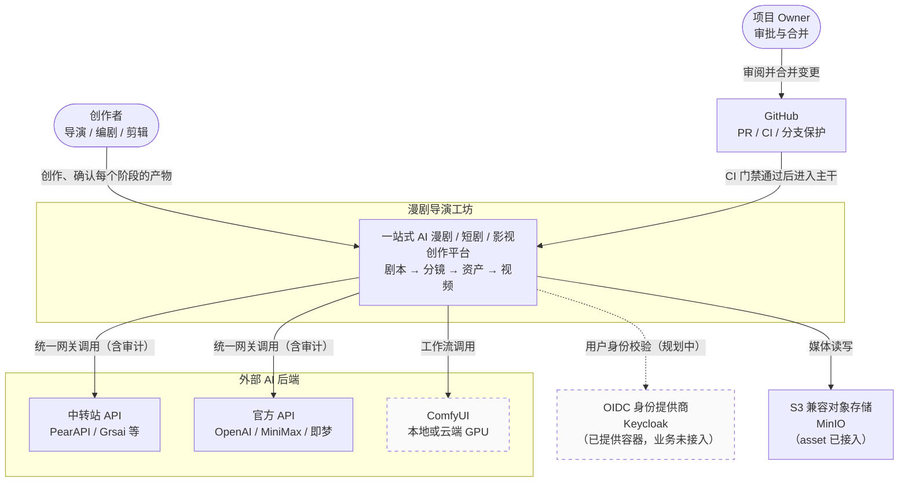
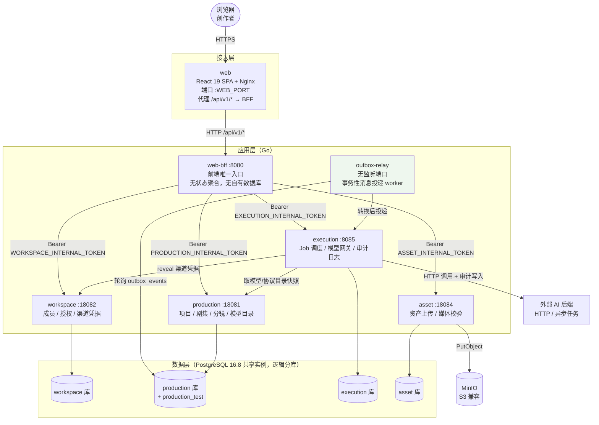
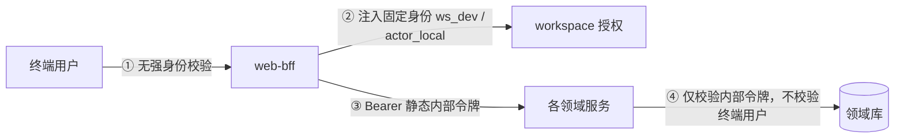

# C4 Context & Container

> 本文件回答：**系统边界在哪、有哪些可部署单元、谁调用谁**。
> 图与代码不一致时以代码为准（事实来源见 [README](README.md#事实来源可复现校验)）。

---

## L1 · 系统上下文（System Context）

谁在用这个系统，它依赖哪些外部系统。

**图注**：虚线/淡色表示**尚未接通**。ComfyUI 执行器属 Phase 2.2/2.3（见 `docs/adr/001`）；OIDC 目前未接入，BFF 使用固定开发身份（见下 L2 与「信任模型」）。

---

## L2 · 容器图（Container）

可独立部署的单元、进程边界、数据存储。

---

## 调用矩阵（谁调用谁、用什么鉴权）

| 调用方 → 被调用方 | 协议 | 鉴权 | 代码位置 |
|---|---|---|---|
| 浏览器 → web | HTTPS | （规划中：OIDC 会话） | — |
| web → web-bff | HTTP `/api/v1/*` | 固定开发身份（`BFF_DEV_*`） | `services/web-bff/cmd/server/main.go` |
| web-bff → workspace / production / execution / asset | HTTP `/internal/v1/*` | `Authorization: Bearer <SERVICE>_INTERNAL_TOKEN` | 同上 |
| execution → production | HTTP | `PRODUCTION_INTERNAL_TOKEN` | `services/execution/internal/engine`+`catalog` |
| execution → workspace | HTTP | `WORKSPACE_INTERNAL_TOKEN` | `services/execution/internal/creds` |
| execution → 外部 AI | HTTP(S) | 渠道凭据（workspace 加密存储，运行时 reveal） | `services/execution/internal/engine/engine.go` |
| outbox-relay → production 库 | PostgreSQL | DSN | `services/outbox-relay/cmd/server/main.go` |
| outbox-relay → execution | HTTP | DSN 中的 execution 地址 | 同上 |
| asset → MinIO | S3 API | `ASSET_S3_ACCESS_KEY` / `ASSET_S3_SECRET_KEY` | `services/asset/internal/asset/store.go` |

**服务间鉴权实现**：下游服务用 `crypto/subtle.ConstantTimeCompare` 比对内部令牌（常量时间，抗时序侧信道），见 `services/workspace/internal/httpapi/handler.go:70`。

---

## 信任模型（当前状态，务必知悉）

- **① 缺口**：浏览器到 BFF 之间没有真实身份校验（无 OIDC/JWT）。BFF 直接采用 `BFF_DEV_WORKSPACE_ID` / `BFF_DEV_ACTOR_ID` 作为身份。
- **② 补偿**：BFF 会拿该身份去 workspace 做一次授权（`errAuthorizationDenied`），因此**越权仍会被拦截**，但身份本身可伪造。
- **③④ 现状**：服务信任「持有内部令牌的调用方」；令牌是静态共享密钥，非 mTLS、非短期凭证。

> **结论**：当前信任模型**仅适用于本地开发/单机验证**，不可直接对外。生产化必须补 OIDC + 短期凭证或 mTLS。此项与 `docs/architecture/00-technical-architecture.md` §14「多租户与安全」的目标态对应，属**已知未完成项**，不是隐形缺陷。

---

## 中间件接入状态（代码实证）

`deploy/local/compose.yaml` 的 `platform` profile 提供以下中间件，但**并非都已接入业务代码**：

| 中间件 | 容器已提供 | 业务代码已接入 | 证据 |
|---|---|---|---|
| PostgreSQL 16.8 | ✅ | ✅ 4 个服务全部使用 | `pgxpool`；`services/*/internal/**/postgres.go` |
| MinIO（S3） | ✅ | ✅ asset 使用 | `services/asset/internal/asset/store.go:113` |
| Redis | ✅ | ❌ **未接入** | Go 代码 0 命中 |
| Kafka + Schema Registry | ✅ | ❌ **未接入** | Go 代码 0 命中 |
| Temporal + UI | ✅ | ❌ **未接入** | Go 代码 0 命中 |
| Keycloak（OIDC） | ✅ | ❌ **未接入** | 无 jwt/oidc 校验；BFF 用固定开发身份 |

**读图提醒**：不要因为 compose 里有 Redis/Kafka/Temporal 就假定架构已使用它们。
`docs/architecture/00-technical-architecture.md` §17 已明确「任务中心、Temporal 业务 Workflow 和 Provider 模拟器尚未实现」。

---

## 相关文档

- 请求/生成的完整流转见 [02-key-sequences.md](02-key-sequences.md)
- 数据归属与分库见 [03-data-model.md](03-data-model.md)
- 本地与目标生产拓扑见 [05-deployment.md](05-deployment.md)
- 为什么网关内置于 execution 而非新建服务：[ADR-001](../adr/001-model-gateway-architecture.md)
