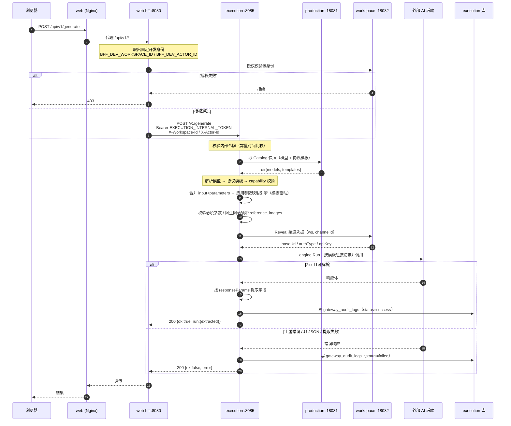
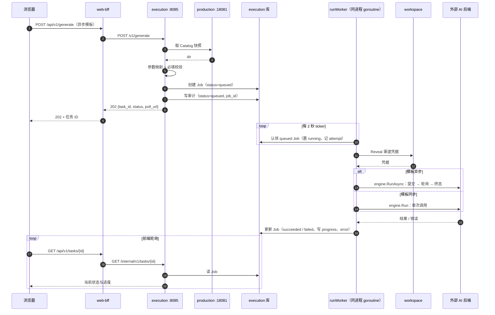
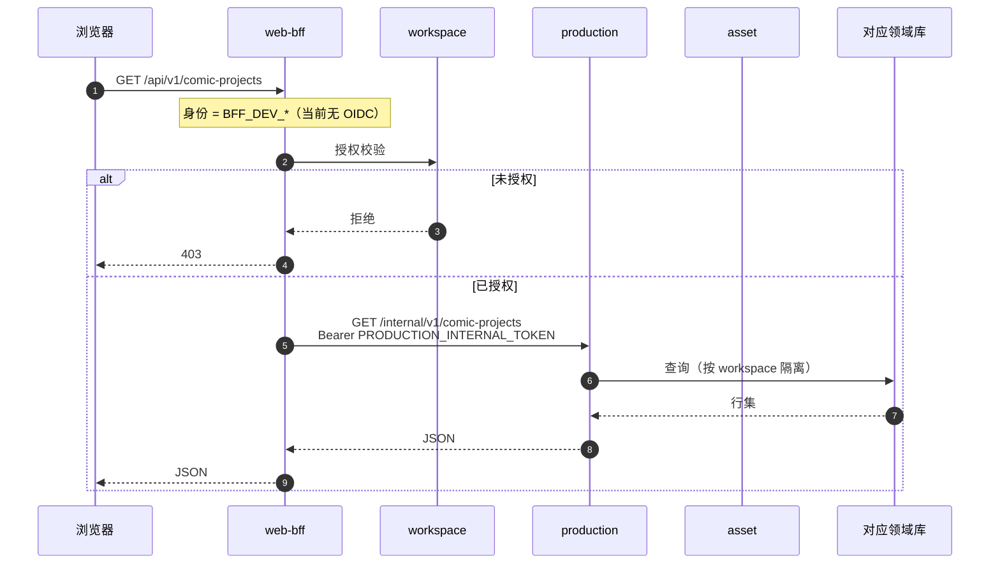
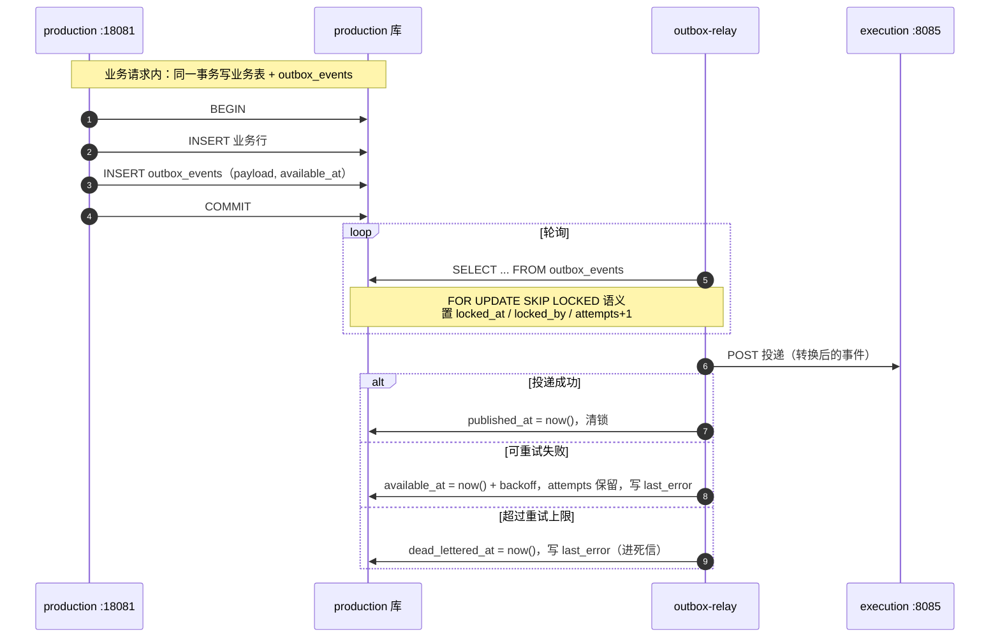

# 关键链路时序图

> 本文件回答：**一次请求或一次生成，到底经过哪些步骤**。
> 所有时序均来自代码实证，事实来源见 [README](README.md#事实来源可复现校验)。

## 为什么这四张图最要紧

系统对外只暴露两件事：**读数据**与**生成内容**。前者决定用户体验，后者决定成本与可审计性。
四条链路覆盖了全部关键路径，也是排障与容量评估的入口。

---

## 时序 1 · 同步生成（网关完整链路）

适用：模板 `async.enabled = false`（如文本对话、同步图片生成）。这是**最完整的链路**，异步链路是它的子集。

**关键设计点**

| 点 | 说明 |
|---|---|
| 审计**同步**写入 | 与业务同请求内完成，不依赖异步管道（`services/execution/internal/httpapi/handler.go`） |
| 上游失败返回 **200 + ok:false** | 不是 5xx：这是「调用已完成但业务失败」，避免调用方误判为网关不可用 |
| 参数映射**模板驱动** | `mapping.NewEngine(tmpl.Capabilities)`；无硬编码映射，符合 AGENTS.md §3.2 |
| 路径优先级 | model 覆盖 > capability 配置 > 模板默认（`handler.go:555`） |
| ⚠️ 路径约定不一致 | 网关路由是 `POST /v1/generate`（`services/execution/internal/httpapi/handler.go:61`），**不在** execution 其余路由所用的 `/internal/v1/*` 约定内。契约已按代码如实记录，但建议统一（改名属破坏性变更，见 [`openapi/README.md`](../../openapi/README.md)） |

> ⚠️ **已知缺陷（待修）**：审计写入的返回值被丢弃 —— `_ = h.AuditStore.Insert(...)`，注释为「audit failure should not block main flow」。
> 这使「审计日志同步写入、不异步丢失」（AGENTS.md §3.4）在**写入失败时退化为静默丢失**。
> 审计是治理事实源，静默丢失会破坏可追溯性。建议：至少记录错误日志/指标；对合规敏感场景改为失败即拒绝或进入重试队列。

---

## 时序 2 · 异步生成（提交 → worker 执行 → 终态）

适用：模板 `async.enabled = true`（视频、长任务）。网关**只负责受理**，真正执行交给 worker。

**关键设计点**

| 点 | 说明 |
|---|---|
| 认领模型 | `queued → running`，记录 `attempt`，避免多 worker 重复执行 |
| worker 位置 | 与 HTTP 服务**同进程**（`cmd/server/main.go:68` `go runWorker(...)`），非独立部署单元 |
| 轮询间隔 | 固定 **2 秒** ticker（`cmd/server/main.go:76`） |
| 执行分流 | 按模板决定 `engine.RunAsync` 或 `engine.Run`（`cmd/server/main.go:223/225`） |
| 幂等 | `jobs.idempotency_key` + `request_hash` 唯一约束，重复提交不产生重复任务 |

> ✅ **已修复（阶段 1 第 2 项）**：worker 现有**并发闸门**（`EXECUTION_MAX_CONCURRENT_JOBS`，
> 默认 8）；闸门满时本轮不派发，任务保持 `running` 由下一轮 ticker 重试，不会永久滞留。
> 失败也不再是终态：`Store.FailOrRetry` 做**指数退避重试**（5s 起、上限 5min、20% 抖动），
> 达 `max_attempts` 才进**死信**（`dead_lettered_at`）。

---

## 时序 3 · 前端读数据（BFF 授权转发）

适用：项目列表/详情、资产列表等所有读路径。**前端永远不直连领域服务。**

**要点**：`workspace` 是**授权事实源**，其他服务只做数据隔离（按 `workspace_id` 过滤），不各自实现权限模型 —— 对应 AGENTS.md §3.1 服务边界。

---

## 时序 4 · outbox 事件投递（事务性消息）

适用：需要「业务写入」与「消息投递」原子一致的场景。**避免分布式事务**。

**关键设计点**：投递语义为 **at-least-once**，消费方必须幂等；`attempts` + 退避 + 死信构成可观测的失败闭环（`services/outbox-relay/cmd/server/main.go`）。

---

## 相关文档

- 系统边界与信任模型见 [01-c4-context-container.md](01-c4-context-container.md)
- 这些时序涉及的表结构见 [03-data-model.md](03-data-model.md)
- Job 与产物的状态流转见 [04-state-machines.md](04-state-machines.md)
