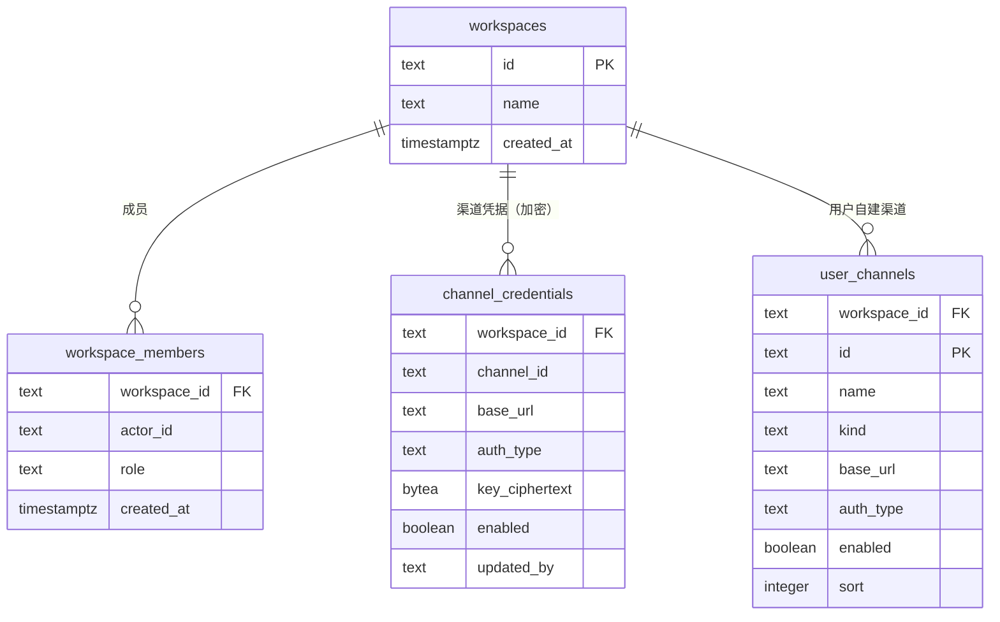
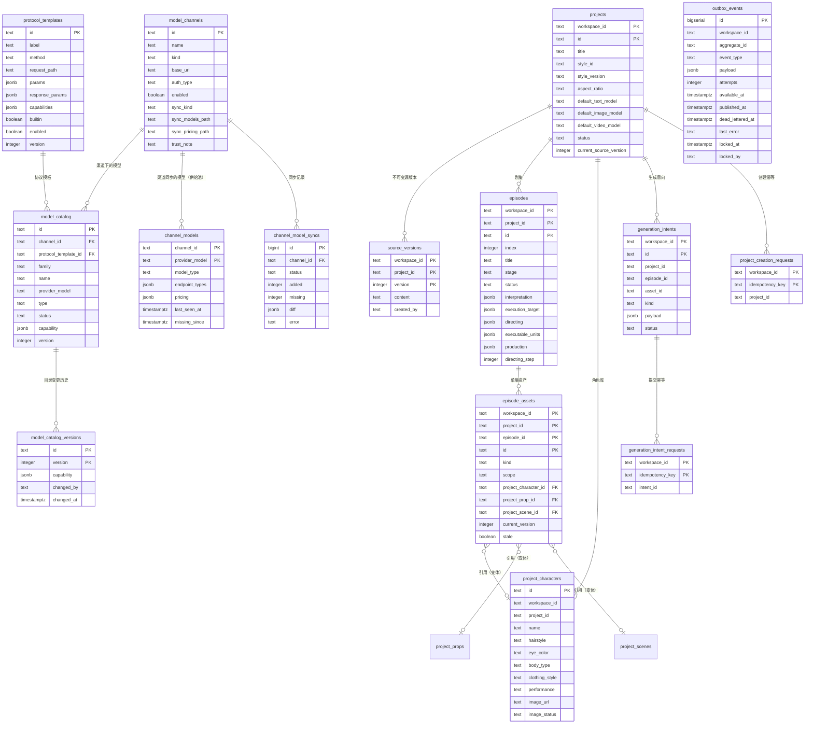
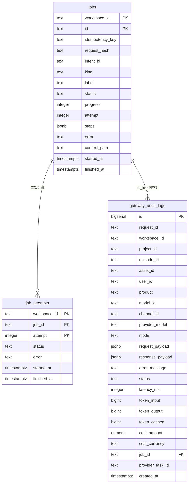
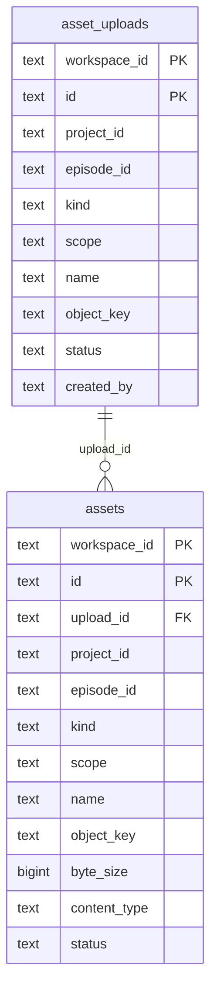

# 数据模型（ER 图）

> 本文件回答：**数据存在哪、表之间怎么关联、为什么这么切分**。
> 完整列定义以各服务 `migrations/*.sql` 为准；本图只画实体、主键与关系，避免与迁移产生双份事实。

## 分库原则（先看这条，再看图）

> **一个服务拥有一类事实，其他服务通过契约访问，不直接跨库读写。** —— AGENTS.md §3.1

四个库可共用同一个 PostgreSQL 实例，但**逻辑上互不越界**：服务 A 不得查询服务 B 的库。
因此下图按库分成四张 ER 图 —— **跨库没有物理外键，只有逻辑引用**（见文末对照表）。

| 库 | 归属服务 | 表数 |
|---|---|---|
| `workspace` | workspace | 4 |
| `production` | production | 14 |
| `execution` | execution | 3 |
| `asset` | asset | 2 |

---

## 1 · workspace 库（租户、成员、渠道凭据）

**要点**：`key_ciphertext` 是**密文**（`bytea`），明文永不出库；execution 运行时通过内部接口 reveal。
密钥集中在 workspace 存储，符合 AGENTS.md §3.4。

---

## 2 · production 库（项目、剧集、资产、模型目录）

> **供给池（`channel_models` / `channel_model_syncs`，迁移 034–037，ADR-004 已确认）**
>
> - **平台级、非租户级**：这两张表**不带 `workspace_id`**，与其父表 `model_channels` 一致
>   （见上方 ER 图 —— `model_channels` 同样没有该列）。故「`workspace_id` 必带」这条惯例
>   对**渠道级/平台级**表不适用；本文在此显式记录该例外。
> - **只写不读**（ADR-004 §9 第 4 项）：同步只写供给池；**任何前端与执行路径都不得读取它**。
>   只有经人工**策展**写入 `model_catalog` 后，模型才可能对外可见。
> - `channel_models.model_type` **刻意不加 CHECK**：它存**上游原样**标签，约束在策展时施加，
>   否则上游多一个 `audio` 标签就会让同步整批失败（ADR-004 §3.1）。
> - 同批迁移还增列：`model_channels`（同步配置 + `trust_note`）与
>   `model_catalog`（`cost_*` / `price_*` 分离 + `price_source` CHECK，ADR-004 D3 与 §9 决策 1）。

### `project_characters` 的建表迁移（2026-10-10 已修复）

| 表 | 被代码/迁移使用 | 建表迁移 |
|---|---|---|
| `project_characters` | ✅ Go 读写（`internal/projectcharacter/postgres.go`）、020 写入 | ✅ `019a_project_characters.sql` |
| `project_props` | 019 引用了列 `project_prop_id`，但**无任何代码读写该表** | 暂不创建（无据不推测） |
| `project_scenes` | 019 引用了列 `project_scene_id`，但**无任何代码读写该表** | 暂不创建（无据不推测） |

**曾经的缺陷**：`project_characters` 被代码与迁移 020 使用，却没有任何迁移创建它。
迁移执行器为 `psql -v ON_ERROR_STOP=1` + `sh -e`（首个错误即整体中止），
因此全新数据库上 020 必然失败、`app` profile 无法启动、021 永不执行。
（CI 不跑 compose 迁移，故长期未暴露。）

**修复方式**（遵守 `AGENTS.md` §7「已执行迁移只增不改」，未修改任何既有文件）：

| 文件 | 作用 |
|---|---|
| `019a_project_characters.sql` | 建表。字典序 `019_ < 019a_ < 020_`，故在 020 之前执行 |
| `019b_project_characters_backfill.sql` | **去重回填**，前置修正 020 的重复主键缺陷（见下） |

**020 的第二个缺陷**（同样已实证）：其 `id = 'pc-' || md5(ea.project_id || '-' || ea.name)`，
而 `NOT EXISTS` 去重只检查**语句执行前**的表状态 —— 当同项目下多个剧集出现同名角色
（主角出现在每一集 = 常态）时，同一条 `INSERT … SELECT` 会插入两行相同 id，
触发 `duplicate key value violates unique constraint "project_characters_pkey"`。

对照实验（同项目两个剧集各有一条同名角色资产）：

| 场景 | 修复前 | 修复后 |
|---|---|---|
| 同项目、**不同名**角色 | ✅ 020 成功 | ✅ 成功 |
| 同项目、**同名**跨剧集角色 | ❌ 主键冲突 | ✅ 成功，合并为 **1 条**角色记录、所有同名资产指向它 |

`019b` 在 020 之前先写入去重后的角色行，使 020 步骤 1 的 `NOT EXISTS` 每行都为真（插入 0 行、不再冲突），
而 020 的步骤 2（建立关联）与步骤 3（清理冗余字段）仍正常执行 —— 最终结果正是 ADR-002 的「引用而非复制」。
同名多行取代表值时，**优先取有立绘的行**，其次取最早创建的行。

> **仍未修复（独立缺陷，另立任务）**：迁移**并非全部幂等** ——
> `006_catalog_response_params.sql` 与 `workspace/004` 的 `ADD COLUMN` 缺 `IF NOT EXISTS`、
> `production/011` 的 `DROP CONSTRAINT` 无守卫，故 compose 的 migrate job（每次 up 重跑全部迁移）
> 第二次执行会在 006 失败。根治办法是让执行器改为**版本跟踪**（`schema_migrations` 表）。

---

## 3 · execution 库（Job、Attempt、审计）

**要点**
- `jobs` 用 `(idempotency_key)` + `request_hash` 实现提交幂等，重复请求不产生重复任务。
- `job_attempts` 以 `(job_id, attempt)` 为主键，保留**每次重试**的独立记录 —— 重试不覆盖历史。
- `gateway_audit_logs` 是**审计事实源**：一条调用一行，含请求/响应载荷、耗时、token 与费用。
  注意其写入失败当前被静默忽略（见 [02-key-sequences.md](02-key-sequences.md#时序-1--同步生成网关完整链路) 的已知缺陷）。

---

## 4 · asset 库（上传会话、资产）

**要点**：上传与会话分离 —— `asset_uploads` 记录「预签名上传会话」，`assets` 在提交后落库元数据。
二进制本体在 MinIO，库里只存 `object_key`，符合 AGENTS.md §3.1「asset 不存业务逻辑」。

---

## 跨库逻辑引用（无物理外键，靠契约保证）

| 来源 | 字段 | 指向 | 一致性保障 |
|---|---|---|---|
| execution.`jobs` | `intent_id` | production.`generation_intents.id` | 提交时由 production 返回，execution 只存 ID |
| execution.`gateway_audit_logs` | `project_id` / `episode_id` / `asset_id` | production / asset | 由调用方（BFF）透传的上下文 |
| execution.`gateway_audit_logs` | `channel_id` / `model_id` | production Catalog | 运行时锁定快照，目录变更不影响历史 |
| production.`episode_assets` | `project_character_id` | production.`project_characters.id` | **同库**，但仍以「引用而非复制」为原则（ADR-002） |
| asset.`assets` | `project_id` / `episode_id` | production | 只存 ID，不联表 |
| workspace.`channel_credentials` | `channel_id` | production.`model_channels.id` | 由 workspace 按 ID 管理凭据，不感知模型语义 |

> **为什么不用跨库外键**：跨库外键会把两个服务的可用性绑死（A 库不可写时 B 也写不了），
> 并让「数据所有权」名存实亡。项目选择用**契约 + 运行时校验**换取服务独立性。

---

## 建模惯例（新增表时请遵循）

| 惯例 | 说明 |
|---|---|
| `workspace_id` 必带 | 所有业务表第一列，用于租户隔离；查询必须带该条件 |
| 幂等表 | 需要防重复提交的写操作配 `*_requests(workspace_id, idempotency_key)` 唯一表 |
| JSONB 承载「结构由模板/规则决定」的载荷 | 如 `capability`、`params`、`interpretation`、`directing`；**不要**为它们建列 |
| 迁移只增不改 | `migrations/NNN_description.sql`，已执行文件禁止修改（AGENTS.md §4.3） |
| 时间列 | 统一 `timestamptz`；`created_at` / `updated_at` 成对出现 |
| 状态列 | 用 `text` + `CHECK` 约束表达状态机，见 [04-state-machines.md](04-state-machines.md) |

---

## 相关文档

- 表的使用时机见 [02-key-sequences.md](02-key-sequences.md)
- 状态列的取值与流转见 [04-state-machines.md](04-state-machines.md)
- 角色库为何是「引用而非复制」：[ADR-002](../adr/002-project-character-library.md)
