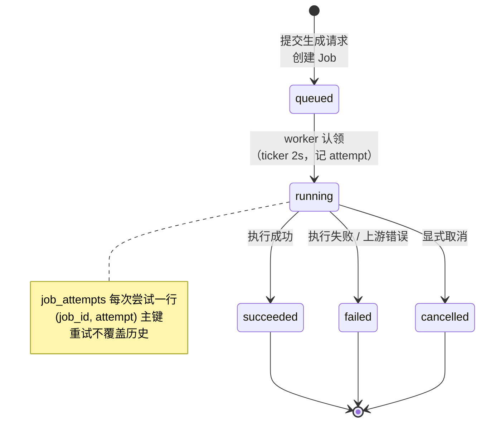
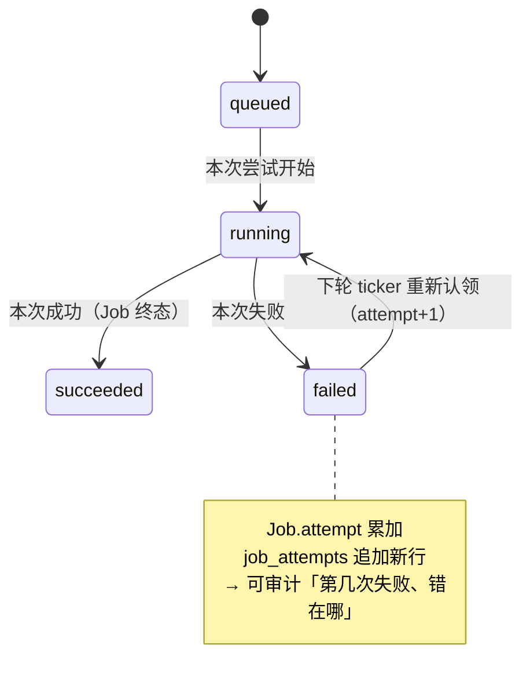
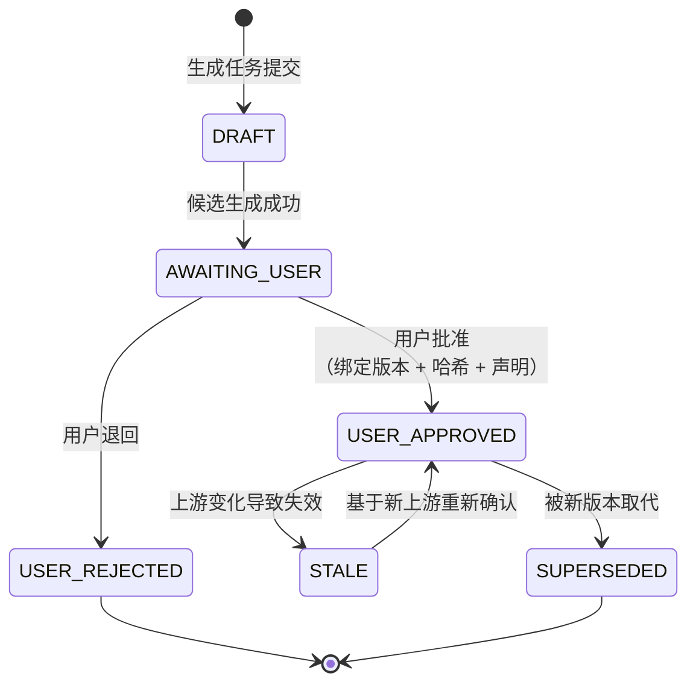
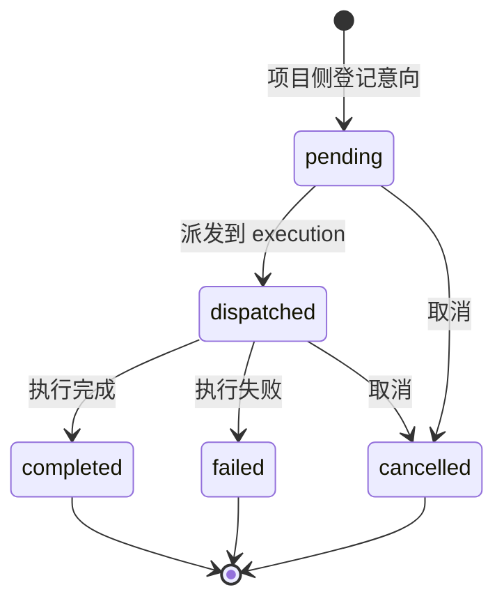
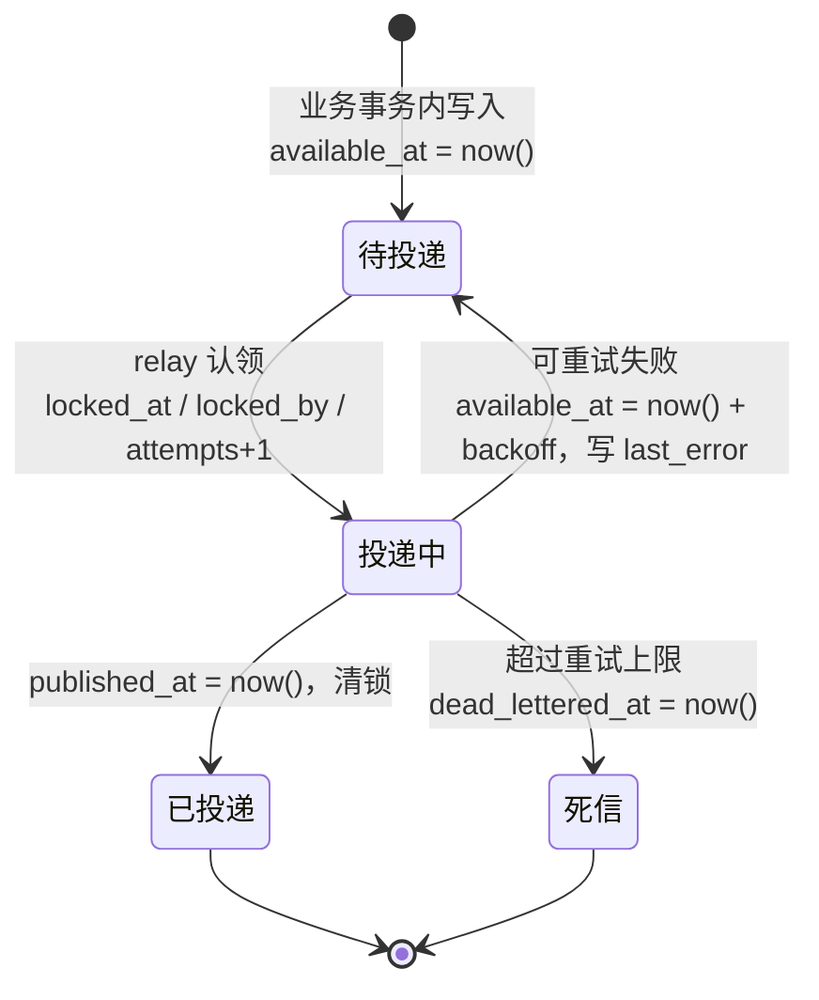

# 状态机

> 本文件回答：**任务与产物如何流转、哪些状态是终态、状态值在 DB 与代码间是否一致**。
> 所有取值来自迁移中的 `CHECK` 约束与 Go/TS 枚举，事实来源见 [README](README.md#事实来源可复现校验)。

## 状态分层（先区分三类，避免混用）

`docs/TECHNICAL_ARCHITECTURE.md` 开篇即强调「三类状态分离」，这是本项目最容易混淆的地方：

| 类别 | 含义 | 载体 | 终态 |
|---|---|---|---|
| **执行任务状态** | 一次调用是否跑完 | `jobs` / `job_attempts` / `TaskStatus` | succeeded / failed / cancelled |
| **内容产物状态** | 产物是否被用户确认 | `ArtifactStatus`（前端领域模型） | USER_APPROVED / USER_REJECTED / SUPERSEDED |
| **项目经营状态** | 项目走到哪个阶段 | `projects.status` / `episodes.stage|status` | archived / done |

---

## 1 · Job 状态机（执行任务）

DB 强约束（`services/execution/migrations/001_execution.sql`）：

**DB 强约束**：`CHECK (status IN ('queued','running','succeeded','failed','cancelled'))`
（`jobs` 与 `job_attempts` 各一条相同约束）

### ⚠️ 不一致 1：`timeout` 无法落库

| 来源 | 取值 |
|---|---|
| DB `CHECK`（`jobs` / `job_attempts`） | queued, running, succeeded, failed, cancelled —— **5 个** |
| Go `engine.TaskStatus` | queued, running, succeeded, failed, cancelled, **timeout** —— **6 个** |

`services/execution/internal/engine/executor.go` 定义了 `TaskStatusTimeout`，但库表约束不允许写入该值。
**后果**：当执行器把超时判定为 `timeout` 时，若按此值持久化会触发 `CHECK` 违反（写失败）；
若映射为 `failed` 则丢失「超时」这一可诊断信息。
**建议**：统一为「DB 与代码同一枚举」，推荐给 `jobs` / `job_attempts` 增加 `timeout`（新迁移，不修改已执行文件）。

---

## 2 · Job Attempt（重试语义）

---

## 3 · 内容产物状态（`ArtifactStatus`）

前端领域模型（`apps/web/src/types/index.ts`）——**这是产品语义的核心**：AI 产出必须经人类确认才成为事实。

| 状态 | 语义 | 是否可继续流转 |
|---|---|---|
| `DRAFT` | 草稿，尚无候选 | ✅ |
| `AWAITING_USER` | 候选已生成，等待用户选择 | ✅ |
| `USER_APPROVED` | 用户批准（绑定版本 + 哈希 + 声明） | ✅（可 STALE / SUPERSEDED） |
| `USER_REJECTED` | 用户退回 | 终态 |
| `STALE` | 上游变化导致失效（**不删除历史**） | ✅ 可重新批准 |
| `SUPERSEDED` | 被新版本取代（**不删除历史**） | 终态 |

> **设计要点**：`STALE` / `SUPERSEDED` 是**标记**而非删除 —— 历史文件与审核记录永久保留，保证可追溯。
> 与 `docs/TECHNICAL_ARCHITECTURE.md` §9「依赖登记冻结上游 artifact_id + version + sha256」一致。

---

## 4 · Generation Intent（生成意向）

DB 强约束（`services/production/migrations/002_generation_intents.sql`），默认 `pending`：

| 来源 | 取值 |
|---|---|
| DB `CHECK` | pending, dispatched, completed, failed, cancelled |
| 幂等表 | `generation_intent_requests(workspace_id, idempotency_key)` 防重复派发 |

---

## 5 · 项目 / 剧集状态（经营状态）

### 5.1 项目状态 —— ⚠️ 不一致 2：服务端实际被冻结

| 来源 | 取值 |
|---|---|
| DB `CHECK`（`001_projects.sql:12`） | `status = 'pending_parse'` —— **仅此一个值** |
| 前端 `ProjectStatus` | pending_parse, parsing, awaiting_confirm, in_production, review, archived —— 6 个 |
| Go 写入路径 | `INSERT ... 'pending_parse'`（字面量）；`Update` 的 `sets` 只含 title/style/aspect_ratio/default_*_model，**不含 status** |

**结论**：`projects.status` 目前是**写入后永不变更**的字段，且 DB 约束禁止任何其它值。
前端的 6 态与 `docs/TECHNICAL_ARCHITECTURE.md` §6 描述的流转属**目标态，服务端尚未实现**。
**建议**：实现状态机时新增迁移放宽 `CHECK`（不要修改已执行迁移），并在 `Update` 中暴露合法的状态跃迁。

### 5.2 剧集阶段与状态 —— ⚠️ 不一致 3：`draft` 只存在于 DB

| 来源 | 取值 |
|---|---|
| DB `episodes.stage` | `text NOT NULL DEFAULT 'analyze'`（**无 CHECK**） |
| DB `episodes.status` | `text NOT NULL DEFAULT 'draft'`（**无 CHECK**） |
| 前端 `EpisodeStage` | analyze, characters, props, scenes, directing, units, production, done（8） |
| 前端 `EpisodeStatus` | pending, analyzing, needs_review, in_work, blocked, done（6）——**不含 `draft`** |

**后果**：新建剧集在库中为 `status='draft'`，而前端类型没有该取值 —— 类型与实际数据不一致
（前端以 `as Episode['status']` 断言后可能渲染出未知状态）。此外 `stage` / `status`
**缺少 DB 层 CHECK**，无法防止写入任意字符串。
**建议**：二选一后统一 ——（a）DB 默认改为 `pending`；（b）前端补 `draft` 取值。并给两列加 `CHECK`。

---

## 6 · 其它受约束的枚举（DB 层已强约束）

| 表 · 列 | 取值 | 位置 |
|---|---|---|
| `jobs.kind` | split, interpret, image, video, audio, canvas_export | execution 001 |
| `asset_uploads.status` | uploading, committed, aborted | asset 001 |
| `assets.kind` | character, prop, scene, script, other | asset 001 |
| `assets.scope` | project, global | asset 001 |
| `episode_assets.kind` | character, prop, scene, other | production 017 |
| `episode_assets.scope` | episode, global | production 017 |
| `workspace_members.role` | owner, admin, editor, viewer | workspace 001 |
| `user_channels.kind` | official, aggregator, local | workspace 003 |
| `user_channels.auth_type` | bearer, apikey, sign, none | workspace 003 |
| `model_channels.kind` | official, aggregator, local | production 004 |
| `model_channels.auth_type` | bearer, apikey, sign, none | production 004 |
| `model_catalog.type` | text, image, video | production 004 |
| `model_catalog.status` | enabled, disabled | production 004 |
| `protocol_templates.method` | POST, GET | production 007 |
| `rule_templates.kind` | split, prompt | production 018 |
| `projects.aspect_ratio` | 16:9, 9:16, 1:1 | production 001 |

---

## 7 · outbox 事件生命周期（无 status 列，用时间戳表达）

**语义**：at-least-once（消费方必须幂等）；无显式 `status` 列，靠 `published_at` / `dead_lettered_at` 区分终态。
详见 [02-key-sequences.md](02-key-sequences.md#时序-4--outbox-事件投递事务性消息)。

---

## 不一致汇总（本文档发现的 3 项，均需修复）

| # | 问题 | 影响 | 建议 |
|---|---|---|---|
| 1 | `TaskStatus.timeout` 无法写入 DB（`CHECK` 仅 5 值） | 超时无法如实持久化，丢失诊断信息 | 新迁移为 `jobs`/`job_attempts` 增加 `timeout` |
| 2 | `projects.status` 被 `CHECK` 冻结为 `pending_parse`，且无更新代码 | 项目状态机在服务端未实现 | 新迁移放宽 `CHECK` + 实现状态跃迁 |
| 3 | `episodes.status` DB 默认 `draft`，前端枚举无此值；两列均无 `CHECK` | 类型与实际数据不一致，脏值可写入 | 统一取值并补 `CHECK` |

> 三项都涉及**已执行迁移**的 `CHECK` 约束，按 AGENTS.md §7 属禁区，需人类决策后以**新增迁移**方式修复（不修改已执行文件）。

---

## 相关文档

- 状态写入发生在哪些链路：[02-key-sequences.md](02-key-sequences.md)
- 状态列所在表结构：[03-data-model.md](03-data-model.md)
