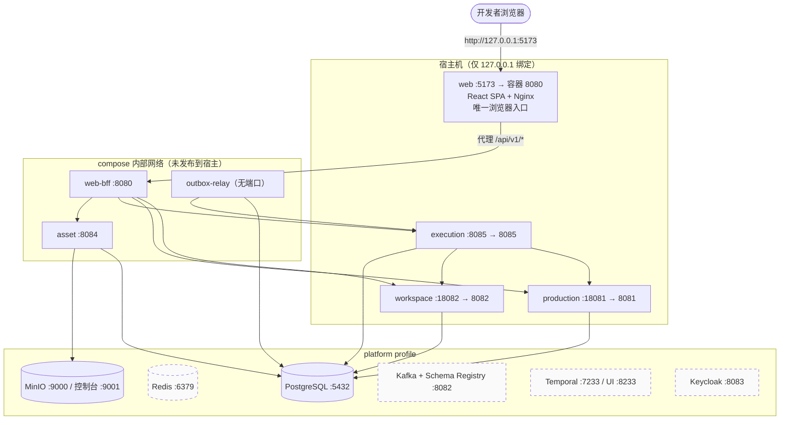
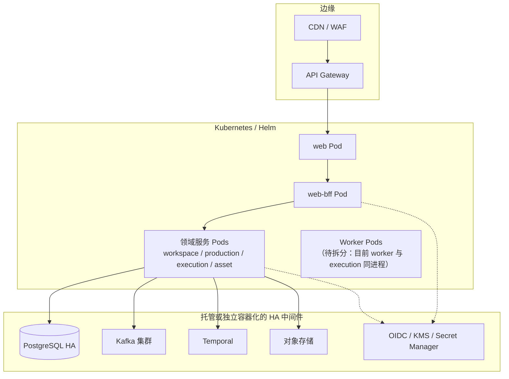

# 部署拓扑

> 本文件回答：**本地怎么跑、端口怎么对应、目标生产形态是什么**。
> 事实来源：`deploy/local/compose.yaml`、`deploy/local/.env.example`、`.env.example`。

## ⚠️ 先分清两种本地运行模式（端口不同，最容易踩坑）

| | 模式 A · 直接跑二进制 | 模式 B · Docker Compose |
|---|---|---|
| 入口 | `AGENTS.md`「常用命令」 | `deploy/local/README.md` |
| 中间件 | 需本机或另起容器提供 | compose 全包 |
| 服务端口 | **宿主端口**（18081/18082/18084/8085/8080） | **容器内端口**（8081/8082/8084/8085/8080） |
| 环境变量 | 根 `.env.example` | `deploy/local/.env.example` |
| 适用 | 单服务调试 | 端到端联调、验收 |

**同一服务在两种模式下端口不同** —— 例如 asset：模式 A 是 `18084`，模式 B 容器内是 `8084`。
根 `.env.example` 面向**模式 A**；compose 会用自己的值覆盖。

---

## 本地拓扑（Docker Compose，模式 B）

**图注**：虚线为**已提供容器但业务未接入**的中间件（Redis / Kafka / Temporal / Keycloak）——
代码实证见 [c4-context-container.md](c4-context-container.md#中间件接入状态代码实证)。
不要因为 compose 里有就假定架构已使用。

---

## 端口对照表（以 compose 为准，可复现）

| 服务 | 容器内监听 | 宿主发布 | 说明 |
|---|---|---|---|
| `web` | `:8080`（Nginx） | `127.0.0.1:${WEB_PORT:-5173}` | **唯一浏览器入口**，代理 `/api/v1/*` 到 BFF |
| `web-bff` | `:8080` | **无**（仅 `expose`） | 不直接对外，只被 web 访问 |
| `workspace` | `:8082` | `127.0.0.1:18082` | 为本地调试开放 |
| `production` | `:8081` | `127.0.0.1:18081` | 为本地调试开放 |
| `asset` | `:8084` | **无**（仅 `expose`） | 只能经 BFF 访问 |
| `execution` | `:8085` | `127.0.0.1:8085` | 为本地调试开放 |
| `outbox-relay` | 无监听 | — | 纯 worker 进程 |
| PostgreSQL | `:5432` | `${POSTGRES_PORT:-5432}` | |
| Redis | `:6379` | `${REDIS_PORT:-6379}` | 容器已起，业务未接 |
| MinIO | `:9000` / `:9001` | `${MINIO_PORT:-9000}` / `${MINIO_CONSOLE_PORT:-9001}` | asset 已接 |
| Kafka + Schema Registry | `:9092` / `:8082` | `${SCHEMA_REGISTRY_PORT:-8082}` | 容器已起，业务未接 |
| Temporal / UI | `:7233` / `:8233` | `${TEMPORAL_PORT:-7233}` / `${TEMPORAL_UI_PORT:-8233}` | 容器已起，业务未接 |
| Keycloak | `:8083` | `${KEYCLOAK_PORT:-8083}` | 容器已起，业务未接 |

> ⚠️ **文档不一致（待修）**：`deploy/local/README.md` 称「Production、Workspace、Asset 与 Web BFF
> **无宿主发布端口**」，但 compose 实际为 production / workspace / execution 发布了 `127.0.0.1:*` 端口
> （仅绑定本机）。准确表述应为「**仅绑定 127.0.0.1，不对外暴露**；asset 与 BFF 完全不发布」。

---

## compose profile 划分

| profile | 内容 | 用途 |
|---|---|---|
| （默认） | PostgreSQL、Redis | 最小依赖 |
| `platform` | \+ MinIO、Kafka + Schema Registry、Temporal + UI、Keycloak | 平台中间件 |
| `app` | \+ production/workspace/asset/execution/outbox-relay/web-bff/web + 各库初始化与迁移 job | 端到端联调 |
| `test` | `production-test`，使用独立测试库（`production_test`），每个集成测试自建并清理 schema | Go 集成测试 |

**迁移执行方式**（重要）：`* -migrate` job 逐个执行 `/migrations/*.sql`，
命令为 `psql -v ON_ERROR_STOP=1 -f "$migration"` 且外层是 `sh -e` —— **首个错误即整体中止**。
这使「迁移序列中任何一步失败」都会导致 `app` profile 起不来（相关缺陷见
[data-model.md](data-model.md#-project_characters-与-project_props--project_scenes-的建表证据缺失)）。

---

## 目标生产形态（规划中，尚未交付）

`docs/architecture/technical-architecture.md` §17 与 `deploy/local/README.md` 均已声明**当前仅交付 web 与 production
的镜像构建文件，不能据此宣称生产容器化或高可用已完成**。目标态要求补齐：
Secret 管理、备份恢复、滚动升级、跨可用区验收；新增中间件或服务必须同时提供可版本化镜像、
健康检查、迁移与容器部署描述，不能依赖宿主机常驻进程。

### 当前与目标的差距

| 项 | 当前 | 目标 |
|---|---|---|
| 部署 | 本地 Compose（单机） | K8s/Helm，多副本 |
| 中间件 | 单节点容器 | 托管/HA 集群 |
| 密钥 | 环境变量注入 | KMS / Secret Manager |
| 身份 | 固定开发身份 | OIDC + 短期凭证 |
| worker | 与 execution 同进程 goroutine | 独立可伸缩 Worker Pod |
| 事件/长任务 | 未接入 Kafka / Temporal | 事件驱动 + 持久化工作流 |
| 可观测 | 标准 `log` 输出 | 指标/追踪/告警（见 `docs/how-to/observability.md`，待补） |

---

## 相关文档

- 容器边界与信任模型见 [c4-context-container.md](c4-context-container.md)
- 迁移与建表证据问题见 [data-model.md](data-model.md)
- 本地启动步骤见 [`../../deploy/local/README.md`](../../deploy/local/README.md) 与 [`../../AGENTS.md`](../../AGENTS.md)「常用命令」
