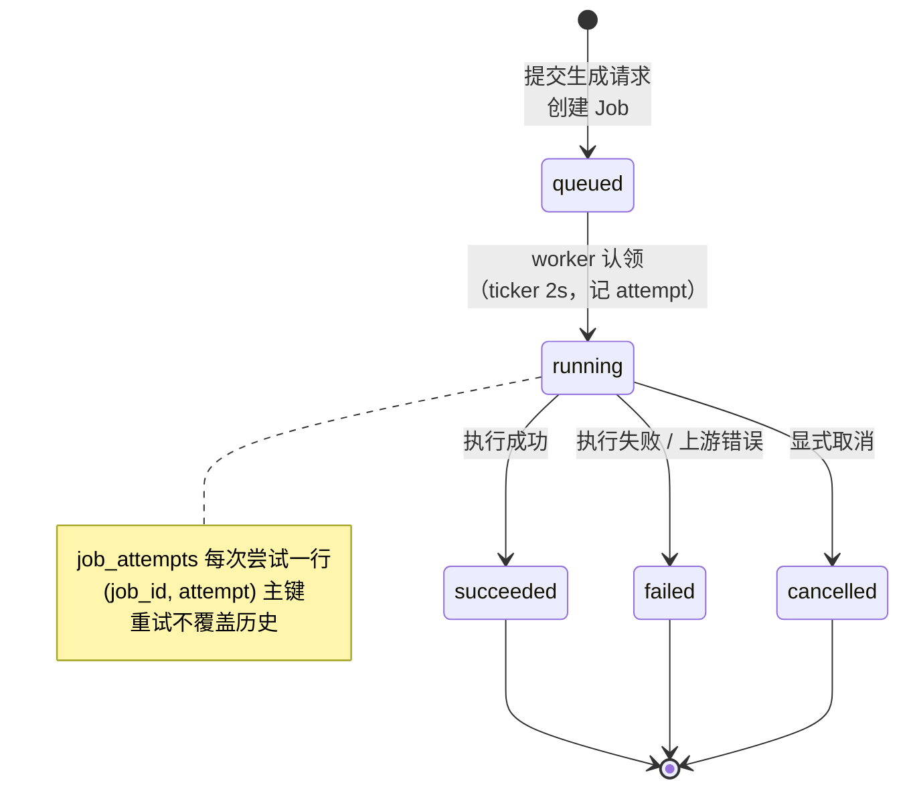
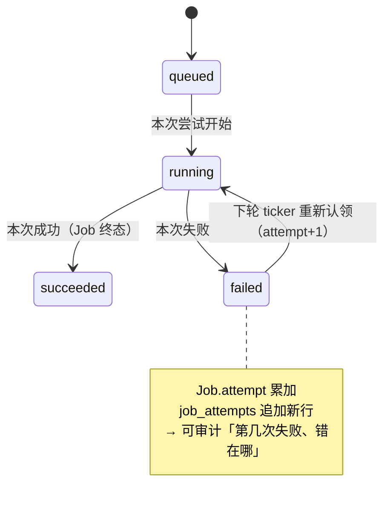
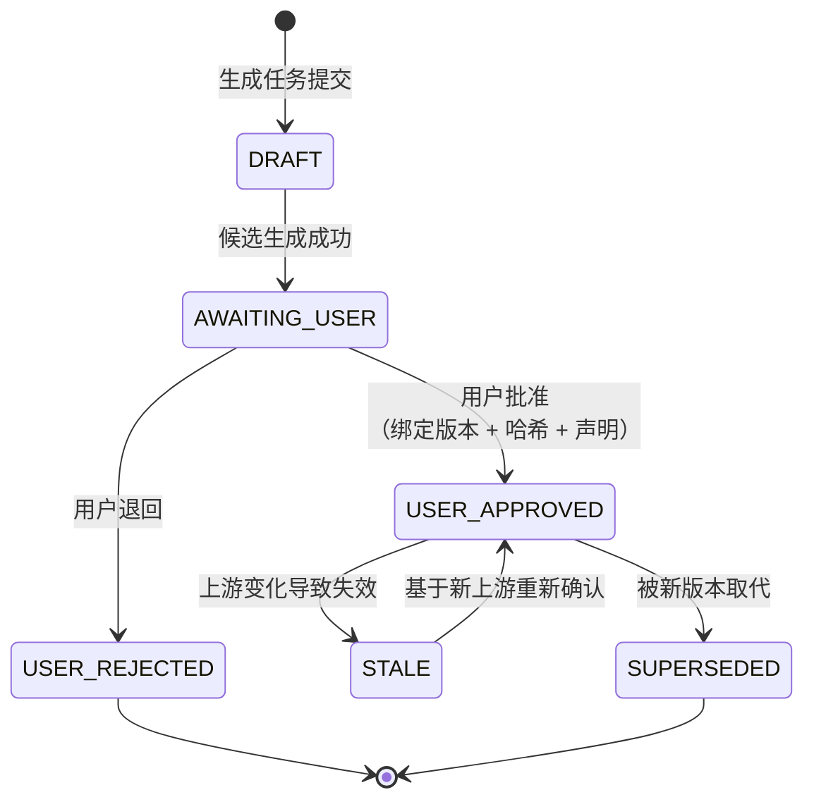
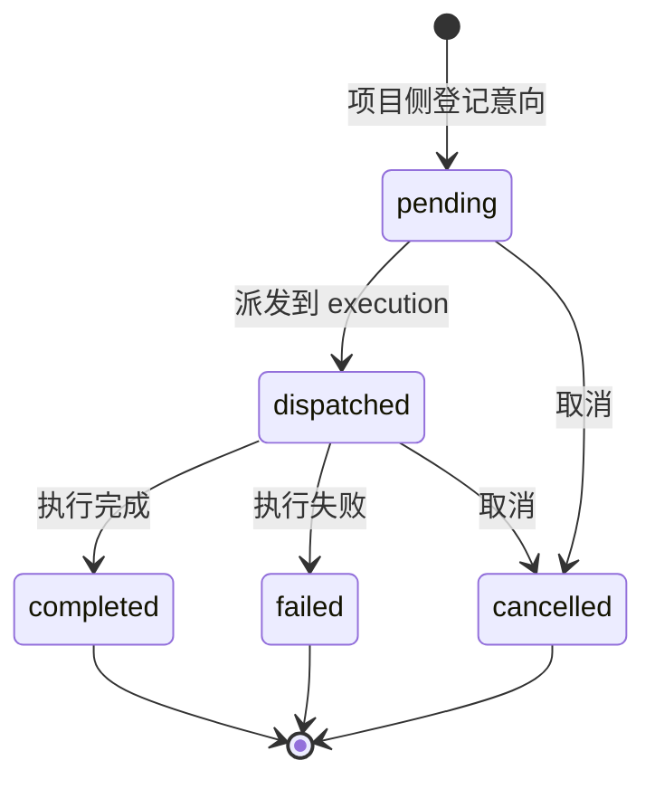
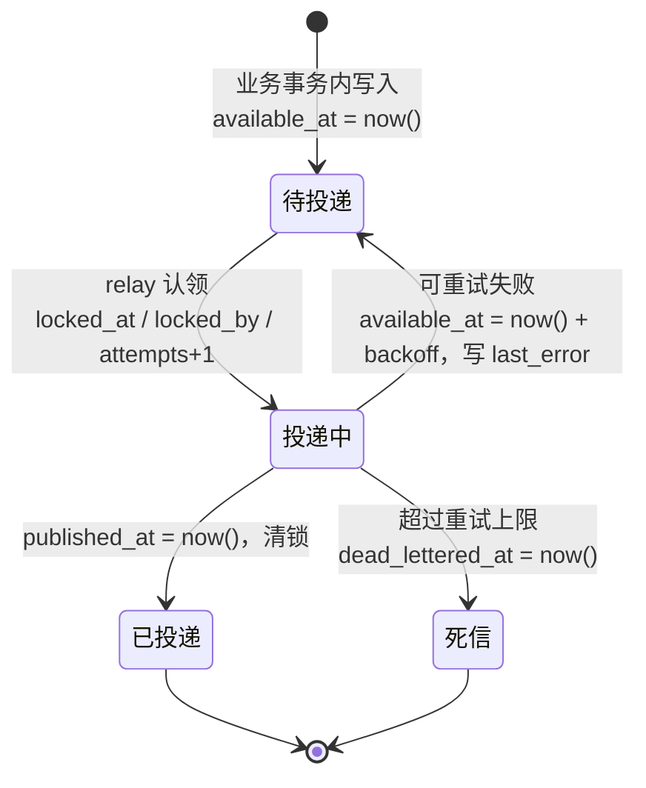

# 状态机

> 本文件回答：**任务与产物如何流转、哪些状态是终态、状态值在 DB 与代码间是否一致**。
> 所有取值来自迁移中的 `CHECK` 约束与 Go/TS 枚举，事实来源见 [README](README.md#事实来源可复现校验)。

## 状态分层（先区分三类，避免混用）

`docs/architecture/technical-architecture.md` 开篇即强调「三类状态分离」，这是本项目最容易混淆的地方：

| 类别 | 含义 | 载体 | 终态 |
|---|---|---|---|
| **执行任务状态** | 一次调用是否跑完 | `jobs` / `job_attempts` / `TaskStatus` | succeeded / failed / cancelled |
| **内容产物状态** | 产物是否被用户确认 | `ArtifactStatus`（前端领域模型） | USER_APPROVED / USER_REJECTED / SUPERSEDED |
| **项目经营状态** | 项目走到哪个阶段 | `projects.status` / `episodes.stage|status` | archived / done |

---

## 1 · Job 状态机（执行任务）

DB 强约束（`services/execution/migrations/001_execution.sql`）：

**DB 强约束**：`CHECK (status IN ('queued','running','succeeded','failed','cancelled'))`
（`jobs` 与 `job_attempts` 各一条相同约束）

### ✅ 已修复 1：`timeout` 现可落库（`007_job_timeout_status.sql`）

| 来源 | 取值 |
|---|---|
| DB `CHECK`（`jobs` / `job_attempts`） | queued, running, succeeded, failed, cancelled, **timeout** —— 6 个 |
| Go `engine.TaskStatus` | queued, running, succeeded, failed, cancelled, **timeout** —— 6 个 |

**曾经的缺陷**：`executor.go` 定义了 `TaskStatusTimeout` 且 `IsTerminal()` 视其为终态，
但 DB `CHECK` 只允许 5 个值 —— 按 `timeout` 持久化会触发约束违反，映射为 `failed` 则丢失
「超时」这一关键诊断信息（超时与业务失败的处理方式、告警阈值完全不同）。

**修复**：新增 `services/execution/migrations/007_job_timeout_status.sql`，
以 `DROP CONSTRAINT IF EXISTS` + `ADD CONSTRAINT` 放宽两个表的取值集合
（未修改已执行文件；先 DROP 后 ADD 使其可重复执行）。
实测：`jobs` 与 `job_attempts` 均可写入 `timeout`，非法取值仍被拒绝。

---

## 2 · Job Attempt（重试语义）

---

## 3 · 内容产物状态（`ArtifactStatus`）

前端领域模型（`apps/web/src/types/index.ts`）——**这是产品语义的核心**：AI 产出必须经人类确认才成为事实。

| 状态 | 语义 | 是否可继续流转 |
|---|---|---|
| `DRAFT` | 草稿，尚无候选 | ✅ |
| `AWAITING_USER` | 候选已生成，等待用户选择 | ✅ |
| `USER_APPROVED` | 用户批准（绑定版本 + 哈希 + 声明） | ✅（可 STALE / SUPERSEDED） |
| `USER_REJECTED` | 用户退回 | 终态 |
| `STALE` | 上游变化导致失效（**不删除历史**） | ✅ 可重新批准 |
| `SUPERSEDED` | 被新版本取代（**不删除历史**） | 终态 |

> **设计要点**：`STALE` / `SUPERSEDED` 是**标记**而非删除 —— 历史文件与审核记录永久保留，保证可追溯。
> 与 `docs/architecture/technical-architecture.md` §9「依赖登记冻结上游 artifact_id + version + sha256」一致。

---

## 4 · Generation Intent（生成意向）

DB 强约束（`services/production/migrations/002_generation_intents.sql`），默认 `pending`：

| 来源 | 取值 |
|---|---|
| DB `CHECK` | pending, dispatched, completed, failed, cancelled |
| 幂等表 | `generation_intent_requests(workspace_id, idempotency_key)` 防重复派发 |

---

## 5 · 项目 / 剧集状态（经营状态）

### 5.1 项目状态 —— ✅ 约束已解冻（`022_projects_status_machine.sql`）

| 来源 | 取值 |
|---|---|
| DB `CHECK`（已由 022 放宽） | pending_parse, parsing, awaiting_confirm, in_production, review, archived —— 6 个 |
| 前端 `ProjectStatus` | 同上 6 个 —— **已与 DB 一致** |
| Go 写入路径 | `INSERT ... 'pending_parse'`（字面量）；`Update` 的 `sets` 仍**不含 status** |

**曾经的缺陷**：`001_projects.sql:12` 的约束为 `CHECK (status = 'pending_parse')` —— **只允许一个取值**，
使项目状态机在数据库层面被彻底冻结（任何推进都会违反约束）。

**修复**：新增 `services/production/migrations/022_projects_status_machine.sql` 放宽约束到前端的 6 态。
实测：可推进到 `in_production` / `review` / `archived`，非法取值仍被拒绝。

> ⚠️ **仍未实现（非约束问题，属功能缺口）**：`project.Update` 的 `sets` 里**没有 status**
> （`postgres.go:104-137`），因此**服务端目前仍无法推进项目状态** —— 该列实际是「写入即冻结」。
> 本迁移只解除约束层面的阻塞，状态机本身（合法跃迁、权限校验、审计）需另行实现。
> `docs/architecture/technical-architecture.md` §6 描述的流转仍属**目标态**。

### 5.2 剧集阶段与状态 —— ✅ 取值已归一并补 CHECK（`023_episodes_state_checks.sql`）

| 来源 | 取值 |
|---|---|
| DB `episodes.status` | `text NOT NULL DEFAULT 'pending'`（**已有 CHECK**，6 个取值与前端一致） |
| DB `episodes.stage` | `text NOT NULL DEFAULT 'analyze'`（**已有 CHECK**，8 个取值与前端一致） |
| 前端 `EpisodeStage` | analyze, characters, props, scenes, directing, units, production, done（8） |
| 前端 `EpisodeStatus` | pending, analyzing, needs_review, in_work, blocked, done（6） |

**曾经的缺陷（两处）**：
1. DB 默认值是 `'draft'`，而前端 `EpisodeStatus` **没有该取值** —— 类型与实际数据对不上；
2. `stage` / `status` **完全没有 CHECK**，而 `episode.Update` 会把请求里的 status 直接写库
   （`postgres.go:107`），意味着任意字符串（含拼写错误）都能落库。

**修复**：新增 `services/production/migrations/023_episodes_state_checks.sql` ——
把历史 `'draft'` 归一为 `'pending'`、默认值改为 `'pending'`、为两列补 CHECK。
**归一方向选择「DB 对齐代码」**（Go 与 TS 已统一使用 `pending`），
只改一处 DB 默认值，无需改动前端类型/UI 分支/mock 数据，变更面最小。

**未预期取值处理**：加约束前先用 `DO` 块做**可读的前置校验**，存在未预期取值时抛出
可操作的错误信息（而非难以定位的 `violates check constraint`），且**刻意不静默改写**未知取值
—— 静默改写会掩盖真实数据问题。实测该路径输出的错误信息包含具体非法取值与归一指引。

实测：新建剧集默认 `pending`；`draft` 与非法 stage 被拒绝；6 个 status、8 个 stage 全部可写入。

---

## 6 · 其它受约束的枚举（DB 层已强约束）

| 表 · 列 | 取值 | 位置 |
|---|---|---|
| `jobs.kind` | split, interpret, image, video, audio, canvas_export | execution 001 |
| `asset_uploads.status` | uploading, committed, aborted | asset 001 |
| `assets.kind` | character, prop, scene, script, other | asset 001 |
| `assets.scope` | project, global | asset 001 |
| `episode_assets.kind` | character, prop, scene, other | production 017 |
| `episode_assets.scope` | episode, global | production 017 |
| `workspace_members.role` | owner, admin, editor, viewer | workspace 001 |
| `user_channels.kind` | official, aggregator, local | workspace 003 |
| `user_channels.auth_type` | bearer, apikey, sign, none | workspace 003 |
| `model_channels.kind` | official, aggregator, local | production 004 |
| `model_channels.auth_type` | bearer, apikey, sign, none | production 004 |
| `model_catalog.type` | text, image, video | production 004 |
| `model_catalog.status` | enabled, disabled | production 004 |
| `protocol_templates.method` | POST, GET | production 007 |
| `rule_templates.kind` | split, prompt | production 018 |
| `projects.aspect_ratio` | 16:9, 9:16, 1:1 | production 001 |

---

## 7 · outbox 事件生命周期（无 status 列，用时间戳表达）

**语义**：at-least-once（消费方必须幂等）；无显式 `status` 列，靠 `published_at` / `dead_lettered_at` 区分终态。
详见 [key-sequences.md](key-sequences.md#时序-4--outbox-事件投递事务性消息)。

---

## 一致性汇总（本文档曾发现的 3 项不一致，**均已修复**）

| # | 问题 | 修复 |
|---|---|---|
| 1 | `TaskStatus.timeout` 无法写入 DB（`CHECK` 仅 5 值） | ✅ `execution/007_job_timeout_status.sql` —— 放宽为 6 值 |
| 2 | `projects.status` 被 `CHECK` 冻结为 `pending_parse` | ✅ `production/022_projects_status_machine.sql` —— 放宽为前端 6 态 |
| 3 | `episodes.status` 默认 `draft` 与前端枚举不符；`stage`/`status` 无 `CHECK` | ✅ `production/023_episodes_state_checks.sql` —— 归一为 `pending` + 两列补 `CHECK` |

三项修复**全部以新增迁移实现，未修改任何已执行文件**（遵守 `.agents/skills/database-migrations/SKILL.md`）。
每个迁移都保证可重复执行（执行器无版本跟踪，会重跑全部文件），
并已用真实 PostgreSQL 16 验证**接受路径与拒绝路径**（不只是 happy path）。

### 遗留的功能缺口（**不是**约束问题，需另行实现）

| 缺口 | 说明 |
|---|---|
| 项目状态机未实现 | 约束已解冻，但 `project.Update` 的 `sets` 不含 `status`，服务端仍无法推进状态 |
| 合法跃迁未校验 | 目前只保证取值合法，不保证跃迁合法（如 `archived` → `parsing` 会被允许） |
| 迁移执行器无版本跟踪 | 每次 compose up 重跑全部迁移；且并非所有迁移都幂等（见 `CHANGELOG.md` Known Issues） |

---

## 相关文档

- 状态写入发生在哪些链路：[key-sequences.md](key-sequences.md)
- 状态列所在表结构：[data-model.md](data-model.md)
