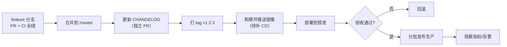

# 发布规范

> 本文件定义版本号、发布流程、回滚与热修。
> **现状（2026-10-10）**：仓库 **0 个 git tag**、无发布流程、CI 只做校验不做交付（无镜像构建/发布）。
> 本文件是目标规范，配套的自动化属 P2「CD 流水线」范围。

## 1. 版本策略

### 1.1 单一版本号（monorepo）

本仓库是 monorepo（`apps/web` + 6 个 Go 服务），**对外按一个产品版本发布**，不单独给服务打版本。

采用**语义化版本** `MAJOR.MINOR.PATCH`：

| 位 | 何时递增 | 例子 |
|---|---|---|
| `MAJOR` | 不兼容的对外变更（`/api/v1/*` 破坏性变更、数据不可逆迁移） | 删除/改名 `api/v1` 字段 |
| `MINOR` | 向后兼容的功能新增 | 新增接口、新增可选字段、新增服务 |
| `PATCH` | 向后兼容的缺陷修复 | bug 修复、文档修正、依赖安全升级 |

**API 版本与产品版本解耦**：URL 里的 `v1` 只在**破坏性契约变更**时递增（见
[`../openapi/README.md`](../../openapi/README.md)），普通功能迭代不动 URL 版本。

### 1.2 版本号落点

| 位置 | 说明 |
|---|---|
| git tag | `v1.2.3`（**权威**） |
| `apps/web/package.json` `version` | 与 tag 保持一致 |
| `CHANGELOG.md` | 每个版本一节 |

Go 服务不写死版本；运行时版本通过构建期注入（`-ldflags "-X main.version=..."`，落地时补）。

## 2. 发布前检查清单

发布人必须逐项确认：

- [ ] `master` 上 CI 全绿（前端门禁 + 6 个后端 + 安全扫描 + 文档检查）
- [ ] `CHANGELOG.md` 已更新，含本次全部用户可见变更
- [ ] 破坏性变更已同步：[`../openapi/`](../../openapi/) 契约、前端调用方、`docs/architecture/00-technical-architecture.md`
- [ ] 有 schema 变更时：迁移文件齐备且**已在预发环境从零跑通**（`psql -v ON_ERROR_STOP=1` 逐文件）
- [ ] 回滚方案已明确（见 §4），且回滚所需的前置条件成立
- [ ] 安全：无新增明文密钥；依赖漏洞扫描无新增高危
- [ ] 文档同步：`AGENTS.md` §2 目录树、`docs/architecture/` 图、相关 ADR

## 3. 发布流程



**当前可执行的部分**：A → B → C → D。E 之后的自动化**尚未交付**，需要人工构建与部署。

### 3.1 打 tag

```bash
git checkout master && git pull --ff-only
git tag -a v1.2.3 -m "release: v1.2.3"
git push origin v1.2.3
```

### 3.2 镜像构建（AGENTS.md §8.3 的产物约定）

```bash
cd services/<service>
go build -o /tmp/mdp-bin/<service> ./cmd/server     # 本地验证
# 容器镜像由各服务 Dockerfile 构建（web-bff/workspace/production/execution/asset/outbox-relay）
```

> 每个服务都有 `Dockerfile` 与 `.dockerignore`；`deploy/local/compose.yaml` 的 `app` profile
> 可作端到端验证环境。

## 4. 回滚

| 场景 | 动作 |
|---|---|
| 应用缺陷（无 schema 变更） | 回退镜像到上一版本 tag；**不要**用 `git revert` 改 master 来救生产 |
| 有 schema 变更 | 优先**前向修复**；因迁移「只增不改」，回退应用可能导致新旧代码与库不一致 |
| 数据损坏 | 走备份恢复流程（**当前备份/恢复尚未交付**，属高可用范围，见 [architecture/05-deployment.md](../architecture/05-deployment.md)） |

**原则**：迁移是**向前兼容**的（新增列可空、不删列、不改语义），使应用可以安全回退一版。

## 5. 热修（Hotfix）

1. 从**当前生产 tag** 拉分支：`hotfix/<简述>-<日期>`
2. 最小改动 + 测试；仍须走 PR 与 CI（**不得**为了赶时间跳过门禁）
3. 合并到 `master` → 打 `PATCH` tag
4. 若 `master` 已含未发布功能而无法直接发，则从 tag 拉 `release/x.y` 分支，修复后打 tag，
   再合并回 `master`（避免功能外泄）
5. 事后 48 小时内补事故复盘（模板见 `.github/INCIDENT_TEMPLATE.md`，待补）

## 6. 与 CI/CD 的关系

| 阶段 | 现状 | 目标 |
|---|---|---|
| CI（校验） | ✅ 已具备：前端门禁 + 6 后端 build/vet/test + gosec + npm audit + 文档检查 | 增加 `golangci-lint`、覆盖率棘轮、依赖更新 |
| 镜像构建 | ❌ 无 | tag 触发构建并推送 OCI 镜像 |
| 部署 | ❌ 无（本地 compose 仅供开发） | Helm/K8s 分环境部署 |
| 发布可见性 | ❌ 无 | GitHub Release + 变更摘要自动生成 |

> **不可宣称已具备生产交付能力**：`docs/architecture/00-technical-architecture.md` §17 已明确
> 「当前仅交付已有 Web 与 Production 的镜像构建文件，不能据此宣称生产容器化或 M5 高可用已完成」。

## 相关文档

- 变更记录：[`../CHANGELOG.md`](../../CHANGELOG.md)
- 接口破坏性变更判定：[`../openapi/README.md`](../../openapi/README.md)
- 部署形态与差距：[architecture/05-deployment.md](../architecture/05-deployment.md)
- 分支与门禁：[docs/development/branch-protection.md](branch-protection.md)
